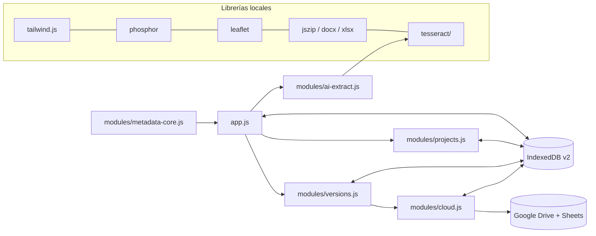

# Mapa del código

Todo vive en `proyecto/proyecto_ia/app/`. No hay build: `index.html` carga los scripts en este orden.

## Archivos

| Archivo | Qué hace |
|---|---|
| `app.js` | Núcleo heredado: estado global, `OfflineStore` (IndexedDB), cámara y estampado, plantillas Word/Excel, mesa de trabajo, exportación. |
| `modules/metadata-core.js` | **IA, parte pura** (sirve en navegador y Node): EXIF, binarización del sello, parser del texto OCR, fusión EXIF+OCR, pie de foto. |
| `modules/ai-extract.js` | **IA, parte navegador**: worker de Tesseract.js, cola de extracción, panel "Datos extraídos por IA", chips en la mesa. |
| `modules/projects.js` | Proyectos múltiples: crear, abrir, editar, eliminar, migración v1→v2. |
| `modules/versions.js` | Versionado de informes y su historial. Expone `window.onReportGenerated`. |
| `modules/cloud.js` | Google Drive y Sheets, y la cola de sincronización diferida. |
| `sw.js` | Service worker: network-first para archivos locales, no intercepta APIs de Google. |
| `lib/tesseract/` | Tesseract.js 5 + núcleo WASM + modelo `eng` LSTM (≈10 MB, offline). |

## Puntos clave dentro de `app.js`

| Función | Para qué |
|---|---|
| `OfflineStore` | Almacenes `app_state`, `projects`, `reports`, `sync_queue` (+ `photos`/`template_data` heredados, solo para migrar). |
| `computePhotoLayout()` | **Modelo único de ajuste**: rotación libre, espejo, fit/cover, proporciones, zoom, paneo. Lo usan la tarjeta, el modal y la exportación. |
| `prepareStampedImageBytes()` | Renderiza cada foto al lienzo 1600×1200 (tamaño uniforme) y estampa si fue tomada con la cámara. |
| `openCropModal()` / `saveCropModal()` | Editor de ajuste (doble clic en una foto). |
| `removeSelectedPhotos()` / `moveSelectedToPage()` | Acciones del modo Seleccionar. |
| `injectPhotosIntoUserDocx()` / `injectPhotosIntoUserXlsx()` | Inyectan fotos en la plantilla del usuario conservando logos. |
| `generateClean…Document()` | Informe sin plantilla propia. |

## Modelo de datos (IndexedDB `GeoPhotoAI_OfflineDB` v2)

- **projects**: `{ id, meta, photos[], template{metadata, rawBuffer}, currentPage }`
  - `meta`: `id, name, code, client, createdBy, status, createdAt, updatedAt, lastReportAt, lastReportVersion, driveFolderId/Url, drivePhotosPath, driveReportsPath, lastReportUrl/Path, driveFolderMode, driveExistingFolder`
  - `photo`: `id, url (dataURL), fileName, rotation, flipH, flipV, scale, fitMode, lockAspect, offsetX/Y, note, coords, meta{capturedAt, lat, lon, via, municipio, departamento, sources, confidence, checks, ocrText…}, driveFileId, driveUrl`
- **reports**: `{ id, projectId, version, major, minor, reason, fileName, blob, createdAt, photoIds, structureHash, contentHash, syncStatus, driveUrl }`
- **sync_queue**: `{ id, type: 'report'|'project', projectId, reportId?, attempts, lastError }`

## Eventos entre módulos
`geophoto:project-changed`, `geophoto:report-saved`, `geophoto:report-synced`, `geophoto:metadata-updated`.

Relacionado: [[Estado actual]] · [[Como ejecutar]]
