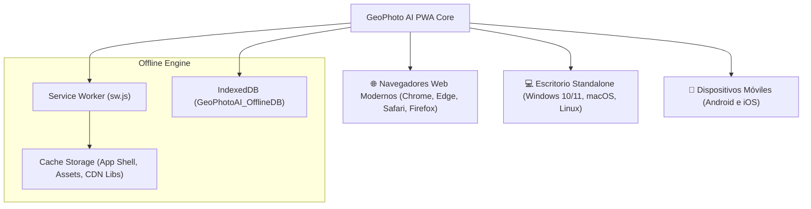
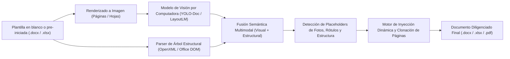

# GeoPhoto Report AI: Sistema Inteligente de Gestión, Estampado Georreferenciado y Diligenciamiento Automático de Reportes Fotográficos

**Proyecto de Grado - Especialización en Inteligencia Artificial**  
**Autor:** Omar  
**Año:** 2024 - 2026  
**Línea de Investigación:** Visión por Computadora y Procesamiento de Documentos (Document Layout Analysis - DLA)  
**Modalidad Tecnológica:** Progressive Web App (PWA) Multiplataforma (Web, Escritorio y Móvil) con Arquitectura 100% Offline-First.

---

## 📌 Resumen Ejecutivo del Proyecto

En sectores como la ingeniería civil, auditorías técnicas, telecomunicaciones, minería, seguros, peritajes y supervisión de obras, la captura y consolidación de evidencias fotográficas en campo es una actividad crítica y altamente repetitiva. Actualmente, los profesionales enfrentan un flujo de trabajo manual y fragmentado:

1. Capturan fotos con aplicaciones móviles comerciales (por ejemplo, *TimeMark*) para estampar coordenadas, fechas y notas.
2. Descargan las fotos a sus equipos de cómputo.
3. Abren plantillas institucionales predeterminadas en **Microsoft Word (.docx)** o **Microsoft Excel (.xlsx)** que exigen estructuras rígidas (número de fotos por página, pies de foto, numeración correlativa, logos corporativos).
4. Redimensionan, recortan y pegan una a una las fotografías en las celdas o recuadros, duplicando páginas manualmente si el reporte supera la capacidad de una sola hoja.

Este proyecto propone una **solución integral PWA y de backend con Inteligencia Artificial** que unifica todo el ciclo de vida:
- **Cámara Inteligente en Campo (100% Offline):** Estampado dinámico y configurable de metadatos (fecha/hora, coordenadas GPS en múltiples formatos, mini-mapa estático de Google Maps / OSM, textos, transparencias, logos corporativos).
- **Comprensión y Reconocimiento Automático de Plantillas con IA:** El usuario carga cualquier plantilla institucional (.docx o .xlsx) y un modelo de Visión por Computadora y Análisis Estructural identifica automáticamente las regiones de inserción fotográfica (*placeholders*), rótulos y estructuras repetitivas, preservando estrictamente logos y encabezados preexistentes.
- **Diligenciamiento y Paginación Dinámica:** Inyección masiva de imágenes respetando la relación de aspecto uniforme, ajuste a los recuadros, replicación automática de páginas/secciones ante excedente de fotos, y reanudación de reportes previamente iniciados.
- **Mesa de Trabajo Interactiva:** Reorganización ágil (drag-and-drop individual o masivo, paginación compacta `P1, P2...`), rotación de 90° con persistencia al exportar, zoom de alta resolución mediante doble clic o Lightbox, ajuste de encuadre (*crop/fit*) y eliminación de fotografías con renumeración correlativa instantánea.
- **Sincronización y Exportación Multicanal:** Generación del reporte nativo final (.docx, .xlsx, PDF), guardado automático en la nube (OneDrive, SharePoint, Google Drive) y envío directo vía WhatsApp, Telegram y correo electrónico.

---

## 📱 Plataforma PWA Multiplataforma y Soporte 100% Offline

GeoPhoto AI ha sido transformado en una **Progressive Web App (PWA)** de última generación, permitiendo su despliegue y uso nativo en tres entornos de trabajo:



### Características de la PWA:
1. **Instalable sin Tiendas de Apps:**
   - **En Escritorio (Windows / Mac / Linux):** Puede instalarse como aplicación de ventana independiente con icono nativo en la barra de tareas o menú inicio vía Microsoft Edge o Google Chrome.
   - **En Móviles (Android):** Prompt nativo de instalación (`beforeinstallprompt`) o banner con un toque para añadir a la pantalla principal como app autónoma.
   - **En iPhone / iPad (iOS):** Instrucciones guiadas integradas para Safari (*Compartir* -> *Añadir a pantalla de inicio*).
2. **Capacidad Offline Autónoma (Zero Data Loss):**
   - **Service Worker (`app/sw.js`):** Precaché del App Shell (`index.html`, `styles.css`, `app.js`, `manifest.json`, iconos) y caché en runtime (Stale-While-Revalidate) de librerías locales y CDNs (Tailwind, Phosphor Icons, JSZip, XLSX, Leaflet).
   - **Persistencia en IndexedDB (`OfflineStore`):** Colección de fotografías en alta resolución, recortes, rotaciones, configuraciones de cámara y los buffers binarios de plantillas Word/Excel (`rawBuffer`) persisten automáticamente ante cierres de ventana, recargas o reinicios de dispositivo, incluso sin conexión a internet.
   - **Cola de Sincronización Diferida (`SYNC_QUEUE`):** Las subidas a la nube pendientes se encolan automáticamente y se procesan tan pronto como se detecta el evento de reconexión (`window.online`).
3. **Doble Experiencia de Usuario (Modo Escritorio y Móvil):**
   - **Modo Marco Móvil:** Diseñado para simulación y uso vertical táctil en teléfonos de campo.
   - **Modo Pantalla Ancha Expandido (`desktop-expanded`):** Accesible mediante el botón de expansión en el encabezado, maximiza la mesa de trabajo para aprovechar monitores anchos (cuadrícula de 4 columnas, visualización masiva de evidencias).

---

## 🚀 Despliegue y Ejecución Rápida

### Opción 1: Lanzador Automático Local (Recomendado)
Haz doble clic sobre el archivo [`iniciar_demo.bat`](file:///c:/Users/omar/Desktop/proyecto_ia/iniciar_demo.bat). Este script detecta automáticamente Node.js o Python en tu sistema, levanta un servidor HTTP local en `http://localhost:8080` (necesario para registrar Service Workers y permitir la instalación PWA) y abre automáticamente el navegador por defecto.

### Opción 2: Ejecución Manual con Node.js
```bash
node scripts/serve.js
```
Luego abre tu navegador en `http://localhost:8080`.

### Opción 3: Instalación de la Aplicación en tu Dispositivo
1. Abre `http://localhost:8080` en Google Chrome o Microsoft Edge.
2. En el encabezado superior derecho, haz clic en el botón azul **"Instalar"** (o en el banner flotante).
3. Acepta el cuadro de diálogo del navegador. GeoPhoto AI se abrirá inmediatamente como una aplicación de escritorio nativa sin barras de navegación del explorador.

---

## 🗂️ Estructura Documental del Proyecto

La documentación técnica y académica se encuentra organizada en cuatro módulos fundamentales:

```
proyecto_ia/
├── README.md                                          <-- Índice general, PWA y resumen ejecutivo
├── iniciar_demo.bat                                   <-- Script de inicio rápido con servidor HTTP PWA
├── scripts/
│   ├── serve.js                                       <-- Servidor HTTP ligero local para PWA
│   └── generate_icons.js                              <-- Generador de iconos PWA multi-resolución
│
├── app/                                               <-- Aplicación PWA Prototipo
│   ├── index.html                                     <-- Estructura HTML5 PWA y vistas modulares
│   ├── styles.css                                     <-- Estilos responsivos, móvil y desktop-expanded
│   ├── app.js                                         <-- Lógica completa, IndexedDB y Service Worker
│   ├── manifest.json                                  <-- Web App Manifest W3C
│   ├── sw.js                                          <-- Service Worker y estrategias de caché offline
│   └── icons/                                         <-- Iconos PNG/SVG (192x192, 512x512, maskable)
│
└── docs/
    ├── 01_propuesta_academica/
    │   ├── 01_planteamiento_problema.md               <-- Justificación, problemática y preguntas de investigación
    │   ├── 02_objetivos_y_alcance.md                  <-- Objetivos general/específicos y límites del proyecto
    │   ├── 03_marco_teorico_y_estado_del_arte.md      <-- DLA, LayoutLM, YOLOv8-Doc, OpenXML y Edge AI
    │   ├── 04_metodologia_y_cronograma.md             <-- Metodología CRISP-DM / CDIO y fases de entrega
    │   └── 05_analisis_benchmark_timemark_timestamp.md<-- Análisis comparativo a fondo: TimeMark vs. Timestamp Camera vs. Proyecto
    │
    ├── 02_especificacion_requisitos/
    │   ├── 01_requerimientos_funcionales.md           <-- Especificación de requerimientos RF-01 a RF-15
    │   ├── 02_requerimientos_no_funcionales.md        <-- Rendimiento, offline-first PWA, usabilidad y seguridad
    │   ├── 03_historias_de_usuario_y_casos_de_uso.md  <-- Casos de uso detallados y criterios de aceptación
    │   └── 04_catalogo_parametros_y_configuraciones.md<-- Catálogo completo de parámetros configurables del sistema
    │
    ├── 03_arquitectura_y_diseno/
    │   ├── 01_arquitectura_del_sistema.md             <-- Diagrama C4, arquitectura PWA / Híbrida Móvil-Escritorio
    │   ├── 02_componente_ia_reconocimiento_plantillas.md <-- Pipeline IA: Visión + OpenXML + Heurísticas
    │   ├── 03_diseno_datos_y_sincronizacion.md        <-- Base de datos local (IndexedDB/SQLite), sync engine y Cloud APIs
    │   ├── 04_diseno_interfaz_y_ux.md                 <-- Guía visual PWA, modo escritorio ancha y móvil
    │   ├── 05_modulo_gestion_y_ajuste_de_formatos.md  <-- Carga, inyección directa Word (.docx), preservación de logos
    │   ├── 06_modulo_comparticion_exportacion_y_nube.md <-- Nomenclatura personalizada, Word/Excel/PDF y nubes
    │   └── 07_mecanismo_reorganizacion_de_fotografias.md<-- Mesa de trabajo interactiva, Drag & Drop y paginación P1/P2
    │
    └── 04_plan_implementacion_y_evaluacion/
        ├── 01_stack_tecnologico_recomendado.md        <-- PWA, Service Workers, IndexedDB, librerías y backend
        ├── 02_metricas_evaluacion_ia.md               <-- Métricas de rendimiento IA (IoU, mAP, Exactitud)
        └── 03_roadmap_y_fases_mvp.md                  <-- Plan de ejecución paso a paso del MVP
```

---

## 🧠 Núcleo de Inteligencia Artificial del Proyecto

El factor diferencial y académico exigido en la Especialización en IA se concentra en la **Comprensión Semántica de Documentos Heterogéneos (Document Layout Analysis - DLA)**:



1. **Detección Visual de Cajas Fotográficas:** Identificación de áreas destinadas a fotos mediante modelos entrenados en análisis de layout de documentos empresariales.
2. **Fusión Semántica con el Árbol OpenXML:** Vinculación de las coordenadas predichas visualmente con los nodos XML reales (`<w:tc>` en tablas de Word o `<c>` en celdas de Excel).
3. **Reconocimiento de Estado Previo:** Detección de celdas que ya poseen imágenes o texto previo para permitir la reanudación del reporte sin sobreescribir información.
4. **Preservación Incondicional de Membretes:** Detección y exclusión de logos, encabezados y pies de página originales para garantizar el 100% de la identidad corporativa de la entidad auditora.
5. **Plantillado Dinámico y Paginación:** Clonación automática del bloque repetitivo con sus proporciones dimensionales intactas cuando la cantidad de fotos seleccionadas supera la capacidad de una página.

---

## 🚀 Navegación Rápida por los Documentos

- Para revisar la justificación y planteamiento académico: [`docs/01_propuesta_academica/01_planteamiento_problema.md`](file:///c:/Users/omar/Desktop/proyecto_ia/docs/01_propuesta_academica/01_planteamiento_problema.md)
- Para el análisis a profundidad de TimeMark y Timestamp Camera: [`docs/01_propuesta_academica/05_analisis_benchmark_timemark_timestamp.md`](file:///c:/Users/omar/Desktop/proyecto_ia/docs/01_propuesta_academica/05_analisis_benchmark_timemark_timestamp.md)
- Para consultar el marco teórico y modelos evaluados: [`docs/01_propuesta_academica/03_marco_teorico_y_estado_del_arte.md`](file:///c:/Users/omar/Desktop/proyecto_ia/docs/01_propuesta_academica/03_marco_teorico_y_estado_del_arte.md)
- Para conocer los requisitos del sistema: [`docs/02_especificacion_requisitos/01_requerimientos_funcionales.md`](file:///c:/Users/omar/Desktop/proyecto_ia/docs/02_especificacion_requisitos/01_requerimientos_funcionales.md)
- Para consultar los requerimientos no funcionales (PWA, Offline): [`docs/02_especificacion_requisitos/02_requerimientos_no_funcionales.md`](file:///c:/Users/omar/Desktop/proyecto_ia/docs/02_especificacion_requisitos/02_requerimientos_no_funcionales.md)
- Para consultar el catálogo completo de parámetros: [`docs/02_especificacion_requisitos/04_catalogo_parametros_y_configuraciones.md`](file:///c:/Users/omar/Desktop/proyecto_ia/docs/02_especificacion_requisitos/04_catalogo_parametros_y_configuraciones.md)
- Para entender la arquitectura del sistema y componentes PWA: [`docs/03_arquitectura_y_diseno/01_arquitectura_del_sistema.md`](file:///c:/Users/omar/Desktop/proyecto_ia/docs/03_arquitectura_y_diseno/01_arquitectura_del_sistema.md)
- Para entender el pipeline de IA detallado: [`docs/03_arquitectura_y_diseno/02_componente_ia_reconocimiento_plantillas.md`](file:///c:/Users/omar/Desktop/proyecto_ia/docs/03_arquitectura_y_diseno/02_componente_ia_reconocimiento_plantillas.md)
- Para el diseño de persistencia y sincronización offline: [`docs/03_arquitectura_y_diseno/03_diseno_datos_y_sincronizacion.md`](file:///c:/Users/omar/Desktop/proyecto_ia/docs/03_arquitectura_y_diseno/03_diseno_datos_y_sincronizacion.md)
- Para el diseño de interfaz de usuario y UX PWA: [`docs/03_arquitectura_y_diseno/04_diseno_interfaz_y_ux.md`](file:///c:/Users/omar/Desktop/proyecto_ia/docs/03_arquitectura_y_diseno/04_diseno_interfaz_y_ux.md)
- Para la subida, ajuste interactivo y cargue en formatos de empresa: [`docs/03_arquitectura_y_diseno/05_modulo_gestion_y_ajuste_de_formatos.md`](file:///c:/Users/omar/Desktop/proyecto_ia/docs/03_arquitectura_y_diseno/05_modulo_gestion_y_ajuste_de_formatos.md)
- Para el módulo de compartición, exportación y nubes (OneDrive, Drive, WhatsApp): [`docs/03_arquitectura_y_diseno/06_modulo_comparticion_exportacion_y_nube.md`](file:///c:/Users/omar/Desktop/proyecto_ia/docs/03_arquitectura_y_diseno/06_modulo_comparticion_exportacion_y_nube.md)
- Para la mesa de trabajo y reorganización ágil de fotos (Drag & Drop): [`docs/03_arquitectura_y_diseno/07_mecanismo_reorganizacion_de_fotografias.md`](file:///c:/Users/omar/Desktop/proyecto_ia/docs/03_arquitectura_y_diseno/07_mecanismo_reorganizacion_de_fotografias.md)
- Para el stack tecnológico y roadmap del MVP: [`docs/04_plan_implementacion_y_evaluacion/01_stack_tecnologico_recomendado.md`](file:///c:/Users/omar/Desktop/proyecto_ia/docs/04_plan_implementacion_y_evaluacion/01_stack_tecnologico_recomendado.md)
