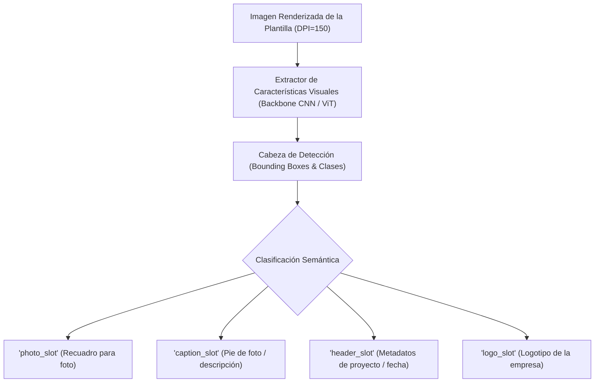

# Marco Teórico y Estado del Arte

**Proyecto:** Sistema Inteligente de Gestión, Estampado Georreferenciado y Diligenciamiento Automático de Reportes Fotográficos en Plantillas Empresariales  
**Programa:** Especialización en Inteligencia Artificial  
**Documento:** `docs/01_propuesta_academica/03_marco_teorico_y_estado_del_arte.md`  

---

## 1. Introducción al Estado del Arte

La automatización de documentos empresariales tradicionalmente ha dependido de macros en VBA (Visual Basic for Applications) o scripts rígidos que exigen plantillas con etiquetas predeterminadas fijas (ej. marcadores de posición como `{{FOTO_1}}`). Sin embargo, en el mundo real, los contratistas, auditores y clientes finales cambian constantemente los formatos o entregan archivos Word y Excel sin etiquetas explícitas.

Para resolver este desafío de manera generalizable, el proyecto se apoya en la convergencia de dos disciplinas de la Inteligencia Artificial y la Ingeniería de Software:
1. **Document Layout Analysis (DLA)** mediante Visión por Computadora y Modelos Multimodales.
2. **Ingeniería Estructural de Documentos Office Open XML (OOXML)**.

---

## 2. Document Layout Analysis (DLA) y Visión por Computadora

El análisis de la disposición física y lógica de documentos busca descomponer una imagen de documento en regiones semánticas (títulos, párrafos, tablas, figuras, cabeceras, firmas y celdas de imagen).

### 2.1. Modelos de Detección de Objetos Aplicados a Documentos
- **YOLO (You Only Look Once - v8 / v9 / v11):**  
  Modelos de detección en una sola etapa (*single-stage*) extremadamente rápidos y ligeros. Al ser entrenados con *datasets* de documentos corporativos (o adaptados mediante transferencia de aprendizaje desde PubLayNet o DocBank), alcanzan una inferencia menor a 40 ms por página. Son candidatos ideales para despliegue en entornos Edge/Móvil o backends ligeros.
- **LayoutLMv3 (Microsoft Research):**  
  Modelo multimodal preentrenado que combina texto (OCR), posición 2D espacial (coordenadas de cajas) e imagen visual mediante un transformador unificado. Resulta excelente para relacionar la etiqueta de texto ("Foto No. 1:") con el recuadro rectangular adyacente.
- **Enfoque Híbrido Propuesto para el Proyecto:**  
  Dado que la plantilla se carga en formato digital nativo (`.docx` / `.xlsx`), no es necesario aplicar OCR destructivo sobre el texto, pues el texto ya existe en el archivo. La combinación más eficiente y robusta consiste en:
  1. Renderizar la plantilla a imagen en alta resolución.
  2. Ejecutar un detector visual (*YOLOv8-Doc fine-tuned*) para delimitar las áreas visuales reservadas para fotografías (`photo_box`).
  3. Cruzar dichas coordenadas espaciales con las celdas del árbol OpenXML del documento original.

---

## 3. Comparativa de Enfoques para Identificación de Plantillas

| Criterio | Enfoque 1: Reglas / Macros Tradicionales | Enfoque 2: OCR Clásico + Expresiones Regulares | Enfoque 3: IA Híbrida (Visión DLA + OpenXML) [Propuesto] |
| :--- | :--- | :--- | :--- |
| **Flexibilidad de formatos** | Nula. Requiere modificar la plantilla para meter etiquetas fijas (`{{FOTO}}`). | Baja. Falla si cambia el orden visual o no hay texto explícito en el recuadro. | **Alta.** Aprende la geometría espacial de tablas y recuadros fotográficos de cualquier empresa. |
| **Soporte de Word y Excel** | Requiere programar macros independientes en VBA para cada formato. | Difícil de asociar con las celdas internas de la hoja. | **Unificado.** Renderiza a imagen, detecta recuadros y mapea a los nodos OpenXML correspondientes. |
| **Detección de estado previo** | Muy propenso a fallar al contar celdas. | No detecta si una imagen ya está incrustada visualmente. | **Nativo.** Detecta imágenes ya presentes en las celdas e inicia el llenado en la siguiente vacía. |
| **Mantenibilidad** | Costosa. Requiere soporte técnico por cada nuevo cliente o formato. | Media. Reglas heurísticas frágiles. | **Alta.** Modelo generalizable con reentrenamiento periódico. |

---

## 4. Manipulación de Documentos Office Open XML (ISO/IEC 29500)

Microsoft Word (`.docx`) y Microsoft Excel (`.xlsx`) son esencialmente contenedores comprimidos (ZIP) que alojan archivos XML estructurados según el estándar OpenXML.

### 4.1. Estructura en Microsoft Word (.docx)
- El contenido principal reside en `word/document.xml`.
- Las tablas se representan mediante el nodo `<w:tbl>`, compuesto por filas `<w:tr>` y celdas `<w:tc>`.
- Las imágenes se declaran en `word/_rels/document.xml.rels` y se insertan en párrafos dentro de celdas mediante nodos `<w:drawing>` que contienen especificaciones de tamaño en unidades EMU (*English Metric Units*: $1 \text{ cm} = 360,000 \text{ EMUs}$).
- **Paginación dinámica:** Word es un formato de flujo continuo (*flow-based*). Para duplicar una página de forma idéntica, el motor debe identificar el nodo de tabla repetitivo o insertar un salto de sección/página (`<w:br w:type="page"/>`) seguido de la clonación del sub-árbol XML de la tabla plantilla.

### 4.2. Estructura en Microsoft Excel (.xlsx)
- El contenido se distribuye en `xl/worksheets/sheet1.xml` con celdas `<c r="B5">`.
- Las imágenes en Excel no se incrustan directamente en el texto, sino en una capa de dibujo flotante (`xl/drawings/drawing1.xml`), vinculada a la cuadrícula mediante anclajes de dos celdas (`<xdr:twoCellAnchor>`).
- El sistema debe calcular las celdas de inicio (`<xdr:from>`) y fin (`<xdr:to>`) que conforman el recuadro detectado por la IA para encajar la imagen con precisión milimétrica.

---

## 5. Estampado Fotográfico Móvil y Georreferenciación

El módulo de captura implementa principios de procesamiento gráfico y geodésico:

### 5.1. Proyecciones y Formatos Geográficos
- **WGS84 Grados Decimales:** Latitud/Longitud estándar (ej. `4.60971, -74.08175`).
- **Grados, Minutos, Segundos (DMS):** Notación tradicional topográfica (ej. `04°36'35.0"N 74°04'54.3"W`).
- **Sistema UTM (Universal Transverse Mercator):** Coordenadas métricas planas (Zona + Hemisferio + Este + Norte), esenciales para obras civiles y topografía.

### 5.2. Renderizado de Capas Gráficas (Watermarking Engine)
La sobreimpresión gráfica se realiza mediante un lienzo digital (*Canvas / 2D Graphics Engine*):
$$\text{Imagen\_Final} = \text{Imagen\_Base} \oplus (\alpha \cdot \text{Overlay\_Fondo}) \oplus \text{Texto\_Metadatos} \oplus \text{Logo} \oplus \text{Mini\_Mapa}$$
Donde $\alpha \in [0.0, 1.0]$ representa el canal alfa de transparencia del fondo del rótulo para garantizar legibilidad independientemente de si la fotografía de fondo es oscura o clara.

---

## 6. Arquitectura Offline-First y Sincronización en la Nube

Para garantizar la continuidad operativa en campo:
- **Almacenamiento Local Transaccional:** Se emplea una base de datos embebida (SQLite) estructurada con tablas de `Proyectos`, `Fotografías`, `Plantillas` y `Cola_Sincronizacion`.
- **Patrón Outbox / Cola de Sincronización:** Cada acción (captura de foto, generación de reporte) genera un evento local persistido con estado `PENDIENTE`. Un servicio en segundo plano monitorea la conectividad de red y despacha las peticiones hacia Microsoft Graph API (OneDrive/SharePoint) o Google Drive API cuando la conexión retorna de forma transparente para el usuario.
