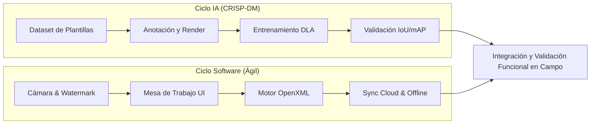

# Metodología de Trabajo y Cronograma

**Proyecto:** Sistema Inteligente de Gestión, Estampado Georreferenciado y Diligenciamiento Automático de Reportes Fotográficos en Plantillas Empresariales  
**Programa:** Especialización en Inteligencia Artificial  
**Documento:** `docs/01_propuesta_academica/04_metodologia_y_cronograma.md`  

---

## 1. Enfoque Metodológico Híbrido

Para asegurar tanto el rigor investigativo de la Especialización en Inteligencia Artificial como la entrega de un producto de software robusto y funcional, se adopta un marco metodológico híbrido:
1. **CRISP-DM (Cross-Industry Standard Process for Data Mining):** Guía el ciclo de vida del modelo de IA (Comprensión del Negocio $\rightarrow$ Comprensión de Datos $\rightarrow$ Preparación de Datos $\rightarrow$ Modelado $\rightarrow$ Evaluación $\rightarrow$ Despliegue).
2. **Metodología Ágil Iterativa (Scrum / Kanban adaptado a proyecto individual):** Organiza el desarrollo del software móvil, servicios backend y conectores de integración en sprints de 2 a 3 semanas.

---

## 2. Fases de Desarrollo del Proyecto

### Fase 1: Análisis, Definición y Recolección de Datos (Semanas 1 - 3)
- Levantamiento de requisitos y formalización de la propuesta de grado.
- Recolección de un *dataset* diverso de plantillas empresariales reales en `.docx` y `.xlsx` (formatos de 2, 4 y 6 fotos por página, tablas simples, tablas con celdas combinadas, etc.).
- Definición de la taxonomía de etiquetas de anotación: `photo_placeholder`, `photo_caption`, `header_info`, `company_logo`.

### Fase 2: Módulo Móvil de Captura, Estampado y Modo Offline (Semanas 4 - 7)
- Implementación de la interfaz de cámara nativa y selector de archivos de galería.
- Desarrollo del motor de estampado configurable (*Watermarking Engine*): fecha, hora, coordenadas GPS (decimales, DMS, UTM), mini-mapa estático, texto libre y logo con control de transparencia.
- Arquitectura de persistencia local en SQLite (gestión de proyectos, fotos capturadas y configuración de plantillas).
- Verificación del funcionamiento 100% desconectado (*offline-first*).

### Fase 3: Núcleo de Inteligencia Artificial y Motor OpenXML (Semanas 8 - 12)
- Pipeline de renderizado de plantillas Office a imágenes de alta definición.
- Entrenamiento / *Fine-Tuning* del detector de layout (YOLOv8-Doc / LayoutLM) sobre el dataset de plantillas.
- Algoritmo de mapeo geométrico-estructural: vinculación de coordenadas de inferencia visual con celdas nativas de Word (`<w:tc>`) y Excel (`<xdr:twoCellAnchor>`).
- Implementación del algoritmo de paginación dinámica: replicación automática del patrón estructural ante excedentes de fotografías.
- Soporte para reanudación de formatos semi-diligenciados (detección de celdas previamente ocupadas).

### Fase 4: Mesa de Trabajo Interactiva y Conectores Cloud (Semanas 13 - 16)
- Desarrollo del panel visual interactivo con soporte de arrastrar y soltar (*drag-and-drop*) individual y en lote para reordenar imágenes.
- Herramientas de edición rápida en la galería: rotación de 90°, recorte rectangular y eliminación.
- Integración con APIs de almacenamiento en la nube: Microsoft Graph API (OneDrive / SharePoint) y Google Drive API con cola de sincronización diferida (*background sync worker*).
- Integración de compartición nativa (WhatsApp, Telegram, Correo Electrónico).

### Fase 5: Pruebas Integrales, Evaluación de Métricas y Documento Final (Semanas 17 - 20)
- Pruebas en condiciones reales de campo (sin internet, bajo sol, diferentes resoluciones).
- Cálculo de métricas formales de IA: IoU medio, mAP@0.5, tasa de éxito en inyección y tiempo de respuesta.
- Redacción del informe final de grado y preparación de la sustentación académica.

---

## 3. Cronograma General de Actividades (Gantt Conceptual)

| Actividad / Semana | S1-2 | S3-4 | S5-6 | S7-8 | S9-10 | S11-12 | S13-14 | S15-16 | S17-18 | S19-20 |
| :--- | :---: | :---: | :---: | :---: | :---: | :---: | :---: | :---: | :---: | :---: |
| 1. Propuesta y Dataset de Plantillas | 🟩 | 🟩 | | | | | | | | |
| 2. App Móvil (Cámara, GPS, Estampado) | | 🟩 | 🟩 | 🟩 | | | | | | |
| 3. SQLite y Persistencia Offline | | | 🟩 | 🟩 | | | | | | |
| 4. Modelo IA (DLA y Detección de Slots) | | | | 🟩 | 🟩 | 🟩 | | | | |
| 5. Motor OpenXML (Inyección y Paginación) | | | | | 🟩 | 🟩 | 🟩 | | | |
| 6. Mesa de Trabajo (Drag-and-Drop, Edición) | | | | | | | 🟩 | 🟩 | | |
| 7. Conectores Nube (OneDrive, Drive, Sync) | | | | | | | | 🟩 | 🟩 | |
| 8. Pruebas de Campo y Métricas IA | | | | | | | | | 🟩 | 🟩 |
| 9. Redacción Memoria y Sustentación | | | | | | | | | 🟩 | 🟩 |

---

## 4. Entregables Académicos y Técnicos

1. **Documento de Memoria de Grado:** Informe final formal con rigor científico, marco teórico, metodología, resultados cuantitativos y conclusiones.
2. **Código Fuente del Proyecto:** Repositorio estructurado y documentado que incluye el cliente móvil, el servicio de backend/IA y los scripts de entrenamiento.
3. **Dataset Anotado y Pesos del Modelo:** Conjunto de plantillas etiquetadas en formato COCO / YOLO y pesos entrenados (`best.pt` / `model.onnx`).
4. **Manual de Usuario y Demostración en Video:** Guía técnica de despliegue y video funcional del flujo completo en campo.
