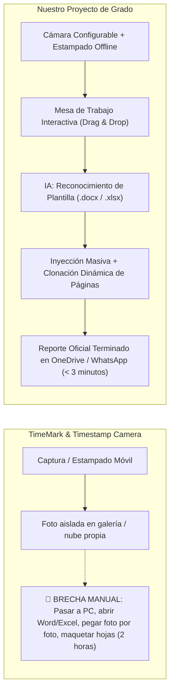

# Análisis Comparativo a Profundidad: TimeMark vs. Timestamp Camera vs. Proyecto Propuesto

**Proyecto:** Sistema Inteligente de Gestión, Estampado Georreferenciado y Diligenciamiento Automático de Reportes Fotográficos en Plantillas Empresariales  
**Programa:** Especialización en Inteligencia Artificial  
**Documento:** `docs/01_propuesta_academica/05_analisis_benchmark_timemark_timestamp.md`  

---

## 1. Introducción al Análisis de Referentes

En el mercado móvil actual existen diversas aplicaciones enfocadas en la captura de evidencias fotográficas con sobreimpresión de datos. Entre ellas, las dos soluciones con mayor adopción y madurez técnica son:
1. **TimeMark (TimeMark Work Camera / Timestamp Camera by TimeMark Global):** Aplicación líder en el sector corporativo, construcción, inspección de obras y trazabilidad de personal en campo.
2. **Timestamp Camera (por Bian Di / Yubin Chen):** La herramienta utilitaria de estampado fotográfico más descargada a nivel global, caracterizada por su alta granularidad y personalización visual.

Este documento realiza un **desglose técnico, funcional y de experiencia de usuario (UX)** de ambas aplicaciones, identificando sus fortalezas, sus limitaciones críticas y el vacío tecnológico (*gap*) que nuestro proyecto de grado resuelve mediante Inteligencia Artificial y manipulación documental nativa.

---

## 2. Radiografía Técnica de TimeMark

```
+-------------------------------------------------------------+
| TimeMark: Enfoque Corporativo y Anti-manipulación          |
+-------------------------------------------------------------+
| [x] Marcas de agua predeterminadas por industria            |
| [x] Sincronización horaria contra servidor de red           |
| [x] Coordenadas GPS y geocodificación inversa (dirección)   |
| [x] Mini-mapa vectorial / satelital estático                |
| [x] Código de autenticidad anti-tamper (código / QR)         |
| [x] Sincronización a nube propietaria ("Teamspace")         |
| [!] Restricción: No permite estampar fotos de galería        |
| [!] Restricción: No admite plantillas Office corporativas    |
| [!] Restricción: Modelo SaaS costoso por usuario/mes        |
+-------------------------------------------------------------+
```

### 2.1. Fortalezas Funcionales
- **Plantillas Temáticas Orientadas a Campo:** Ofrece sellos predefinidos para construcción, inspección de obras, seguridad ocupacional y control de entregas.
- **Trazabilidad y Autenticidad (*Anti-Tamper*):** TimeMark bloquea la alteración de la hora del sistema sincronizándola con servidores de red y asigna un código hash o QR único por fotografía para garantizar validez legal o contractual.
- **Geocodificación Automática:** Convierte en tiempo real las coordenadas numéricas en direcciones postales comprensibles (calle, ciudad, departamento).
- **Mini-Mapa Embebido:** Integra en la esquina inferior un recorte cartográfico con pin de localización satelital.

### 2.2. Limitaciones Críticas Identificadas
1. **Bloqueo a Fotos de la Galería:** Por su estricta política de autenticidad, TimeMark generalmente **impide o restringe estampar fotografías previamente tomadas** o descargadas en el dispositivo, lo que frustra al usuario cuando la foto fue capturada con otra cámara, dron o antes de abrir la app.
2. **Exportación Cerrada y Rígida:** Aunque permite generar PDFs o tablas en Excel simples desde su portal web (*Teamspace*), estos formatos son diseños fijos de TimeMark. **No permite al usuario subir la plantilla oficial en Word o Excel que su empresa, contratista o interventoría le exige**.
3. **Cero Inteligencia en Maquetación de Documentos:** No comprende la estructura de un documento externo ni inyecta fotos en celdas específicas.
4. **Dependencia de Ecosistema Propietario de Pago:** La consolidación de fotos y reportes exige pagar suscripciones recurrentes por cada usuario en su plataforma web cerrada.

---

## 3. Radiografía Técnica de Timestamp Camera (Bian Di)

```
+-------------------------------------------------------------+
| Timestamp Camera: Enfoque Utilitario y Alta Personalización |
+-------------------------------------------------------------+
| [x] Más de 60 formatos de fecha y hora (milisegundos)       |
| [x] Posicionamiento en 7 zonas de pantalla                  |
| [x] Control deslizante de opacidad de texto y de fondo       |
| [x] Múltiples formatos de coordenadas (GPS, altitud, brújula)|
| [x] Soporte para importar y estampar fotos de galería (Pro) |
| [x] Inserción de logos personalizados y firmas              |
| [!] Restricción: Se limita exclusivamente a la cámara/foto   |
| [!] Restricción: No gestiona proyectos ni expedientes       |
| [!] Restricción: No genera reportes documentales            |
| [!] Restricción: Publicidad invasiva en versión gratuita    |
+-------------------------------------------------------------+
```

### 3.1. Fortalezas Funcionales
- **Granularidad Extrema de Personalización Visual:** Permite elegir entre más de 60 combinaciones de formato de fecha/hora, múltiples tipografías, colores de texto, tamaños y grosores de borde.
- **Control de Transparencia / Opacidad:** Cuenta con controles deslizantes dedicados para regular la opacidad tanto del texto como del fondo rectangular (*background opacity*), lo que evita tapar detalles relevantes de la foto.
- **Flexibilidad de Ubicación Espacial:** Permite fijar el estampado en 7 posiciones predefinidas (arriba a la izquierda, centro, abajo a la derecha, etc.).
- **Datos Geodésicos Completos:** Además de latitud y longitud, muestra altitud, velocidad de desplazamiento, rumbo magnético de la brújula y mini-mapa.
- **Soporte de Galería:** Permite estampar metadatos tanto en tiempo real como sobre imágenes existentes de la memoria del teléfono (versión Pro).

### 3.2. Limitaciones Críticas Identificadas
1. **Alcance Limitado a Nivel de Imagen:** La aplicación culmina su ciclo de vida en el momento en que la foto se guarda en el carrete del móvil. No ofrece ningún paso posterior hacia la generación del reporte.
2. **Falta de Organización Estructurada:** No existe el concepto de "Proyecto", "Frente de Obra" ni carpetas lógicas corporativas; todas las fotos se mezclan en la galería general.
3. **Nula Integración con Microsoft Office:** El usuario debe trasladar manualmente las decenas de fotos a su computadora y pegarlas una a una en su formato de Word o Excel.

---

## 4. Matriz Comparativa Detallada: Benchmark Competitivo

| Característica / Módulo | TimeMark | Timestamp Camera (Bian Di) | Proyecto Propuesto con IA |
| :--- | :---: | :---: | :---: |
| **Estampado de Fecha / Hora Configurable** | ✅ Sí (Fija/Sincronizada) | ✅ Sí (+60 estilos) | ✅ **Sí (Configurable)** |
| **GPS Multiformato (Decimal, DMS, UTM)** | ⚠️ Solo Decimal/Dirección | ⚠️ Decimal / Grados | ✅ **Decimal, DMS y UTM** |
| **GPS Opcional (Encender/Apagar)** | ❌ Obligatorio | ✅ Opcional | ✅ **Opcional según caso** |
| **Mini-Mapa de Ubicación en Estampado** | ✅ Sí | ✅ Sí | ✅ **Sí (Google/OSM estático)** |
| **Control de Opacidad / Transparencia** | ⚠️ Muy limitado | ✅ Sí (Slider dedicado) | ✅ **Sí (0% a 100% en vivo)** |
| **Inclusión de Logotipo Empresarial** | ✅ Sí | ✅ Sí | ✅ **Sí (Personalizable)** |
| **Estampar Fotos Nuevas y de Galería** | ❌ Solo fotos en vivo | ✅ Sí (Versión Pro) | ✅ **Ambas opciones nativas** |
| **Gestión Estructurada por "Proyectos"** | ✅ Sí (Teamspace) | ❌ No | ✅ **Sí (Base de datos local)** |
| **Carga de Plantillas Word (.docx) y Excel (.xlsx)** | ❌ No | ❌ No | ✅ **Sí (Formatos propios de cada empresa)** |
| **Detección de Recuadros con IA (DLA)** | ❌ No | ❌ No | ✅ **Sí (YOLOv8-Doc / LayoutLM)** |
| **Paginación Dinámica y Clonación de Páginas** | ❌ No | ❌ No | ✅ **Sí (Automática según número de fotos)** |
| **Detección de Fotos Previas (Reanudación)** | ❌ No | ❌ No | ✅ **Sí (Continúa desde el slot libre)** |
| **Mesa de Trabajo (Drag & Drop, Rotar, Recortar)** | ❌ No | ❌ No | ✅ **Sí (Canvas interactivo)** |
| **Ajuste Automático de Proporción a Celdas** | ❌ No | ❌ No | ✅ **Sí (Aspect ratio fit)** |
| **Exportación a Word, Excel y PDF Diligenciado** | ⚠️ Solo PDF/Excel rígido | ❌ No | ✅ **Sí (En el formato nativo del cliente)** |
| **Guardado en OneDrive, Google Drive, SharePoint** | ⚠️ Solo nube de TimeMark | ❌ No | ✅ **Sí (APIs corporativas directas)** |
| **Compartir Directo (WhatsApp / Telegram / Email)** | ⚠️ Solo fotos sueltas | ⚠️ Solo fotos sueltas | ✅ **Sí (Reporte consolidado listo)** |
| **Modo 100% Offline-First con Sync Posterior** | ⚠️ Requiere red para Team | ✅ Local en dispositivo | ✅ **100% Offline con Sync Outbox** |

---

## 5. El Salto de Valor del Proyecto de Grado



### 1. Fusión de lo mejor del estampado en campo:
Adoptamos la **flexibilidad visual de Timestamp Camera** (transparencias precisas, coordenadas UTM indispensables en ingeniería y topografía, libertad de activar/desactivar GPS, soporte total para fotos de galería) y la **seriedad corporativa de TimeMark** (organización por proyectos, mini-mapas, notas claras y sellos legibles).

### 2. Eliminación radical del cuello de botella documental:
Ni TimeMark ni Timestamp Camera interactúan con la ofimática real de las empresas. El usuario siempre termina pasando horas frente a la computadora maquetando tablas de Word o Excel. Nuestra solución introduce **Inteligencia Artificial para Document Layout Analysis**, permitiendo que el formato que la empresa use —sin importar quién lo diseñó— sea leído, comprendido e inyectado con decenas de fotografías en cuestión de segundos.

### 3. Independencia de nubes cerradas y soberanía de datos:
En lugar de forzar a las organizaciones a pagar licencias de una plataforma SaaS adicional para ver sus fotos (como hace TimeMark), el sistema deposita los reportes directamente en la infraestructura que la empresa ya paga y utiliza: **Microsoft 365 (OneDrive / SharePoint) y Google Workspace (Google Drive)**.
