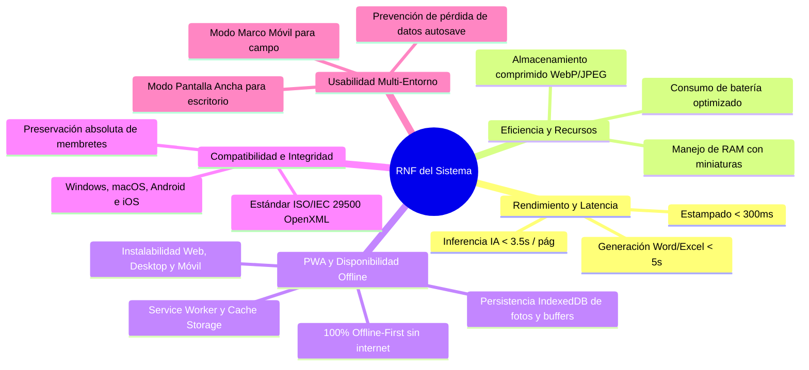

# Especificación de Requerimientos No Funcionales (RNF)

**Proyecto:** Sistema Inteligente de Gestión, Estampado Georreferenciado y Diligenciamiento Automático de Reportes Fotográficos en Plantillas Empresariales  
**Programa:** Especialización en Inteligencia Artificial  
**Modalidad Tecnológica:** Progressive Web App (PWA) Multiplataforma (Web, Escritorio y Móvil) Offline-First  
**Documento:** `docs/02_especificacion_requisitos/02_requerimientos_no_funcionales.md`  

---

## 1. Clasificación de Requerimientos No Funcionales

---

## 2. Detalle de Requerimientos No Funcionales

### RNF-01: Rendimiento y Tiempos de Respuesta
1. **Latencia de Estampado Gráfico:** El tiempo transcurrido desde el disparo de la cámara hasta la generación de la fotografía estampada y su guardado local no debe superar los **300 milisegundos**.
2. **Latencia de Inferencia del Modelo de IA:** El análisis de una página de plantilla (`.docx` o hoja de `.xlsx`) para la detección de recuadros de fotos no debe superar los **3.5 segundos por página** en backend y **5 segundos** si se ejecuta en Edge/Navegador cliente.
3. **Tiempo de Generación del Documento Final:** La inyección masiva, ajuste dimensional uniforme y empaquetado de un reporte de 30 fotografías distribuidas en múltiples páginas no debe superar los **5.0 segundos**.

---

### RNF-02: Arquitectura PWA Multiplataforma e Instalabilidad (Web, Escritorio y Móvil)
1. **Estándar Progressive Web App (PWA):** La aplicación debe cumplir al 100% los estándares W3C de Progressive Web Apps, incluyendo:
   - Manifiesto de Aplicación Web (`manifest.json`) con nombre, descripción, esquema de colores temáticos (`#0f172a`), categorías, accesos directos (*Shortcuts*) e iconos adaptativos (*maskable* y regulares de 192x192 y 512x512 px).
   - Visualización en modo independiente (`display: "standalone"`) sin barras de navegación del explorador, brindando apariencia y comportamiento de software nativo.
2. **Soporte Multi-Dispositivo:**
   - **Escritorio (Windows 10/11, macOS, Linux):** Instalable mediante Microsoft Edge o Google Chrome como ventana nativa ejecutable desde el menú inicio o barra de tareas.
   - **Móvil (Android):** Instalable mediante eventos `beforeinstallprompt` o botón de descarga directa en pantalla.
   - **Móvil (iOS / iPadOS):** Compatible con Safari mediante metaetiquetas `apple-mobile-web-app-capable` y guía interactiva integrada (*Compartir* -> *Añadir a pantalla de inicio*).

---

### RNF-03: Disponibilidad y Modo Offline-First (100% Autónomo sin Conexión)
1. **Autonomía Operativa Total sin Internet:** El usuario debe poder ejecutar el 100% de los flujos de trabajo (toma fotográfica, estampado de coordenadas y fecha/hora, recorte, rotación, carga de plantillas Word/Excel, inyección en celdas y exportación) sin requerir conectividad de datos móviles ni señal Wi-Fi.
2. **Estrategia de Caché de Service Worker (`sw.js`):**
   - **Pre-caching (Cache-First):** En la fase de instalación del Service Worker, el núcleo de la aplicación (*App Shell*: `index.html`, `styles.css`, `app.js`, `manifest.json`, iconos y librerías locales empaquetadas como JSZip y SheetJS) debe almacenarse en el *Cache Storage*.
   - **Runtime Caching (Stale-While-Revalidate):** Los recursos externos y CDNs (Tailwind CSS, Phosphor Icons, Leaflet Maps) deben responder inmediatamente desde la caché local mientras se valida en segundo plano si existe una versión actualizada.
3. **Persistencia Local Robusta con IndexedDB (`OfflineStore`):**
   - A diferencia de `localStorage` (limitado a 5 MB y solo strings), la aplicación debe utilizar una base de datos local **IndexedDB (`GeoPhotoAI_OfflineDB`)** con almacenes dedicados (`photos`, `template_data`, `app_state`, `sync_queue`).
   - El buffer binario nativo del documento Word/Excel (`state.template.rawBuffer`), así como todas las imágenes cargadas o capturadas en base64/blobs, deben guardarse automáticamente mediante autosave reactivo cada vez que ocurra un cambio.
4. **Cola de Sincronización Diferida (Outbox Pattern):** Cuando el operario intente subir un reporte a nubes corporativas (OneDrive, Google Drive, SharePoint) en estado offline, la tarea no debe fallar; se encola en la lista de sincronización y se despacha automáticamente tan pronto como el sistema operativo emita el evento nativo `online`.

---

### RNF-04: Gestión de Memoria y Eficiencia Técnica (Dual Proxy / Hi-Res)
1. **Reducción Temporal de Calidad para Organización Ágil (Proxies Ligeros):** Durante la maquetación interactiva en la mesa de trabajo (Drag & Drop, rotación, recorte, paginación P1/P2), la aplicación renderiza previsualizaciones optimizadas en el DOM para mantener una fluidez constante a 60 FPS sin saturar la memoria RAM del navegador.
2. **Restauración Obligatoria a Máxima Calidad Técnica en la Exportación:** Al momento de generar el archivo `.docx` o `.xlsx`, el motor procesa directamente las imágenes en su resolución completa original, asegurando que las evidencias periciales mantengan el 100% de su nitidez y fidelidad técnica.
3. **Consumo de Batería:** El uso del sensor de geolocalización debe solicitarse bajo demanda en el momento de la captura fotográfica, evitando el sondeo continuo que agota prematuramente la batería del teléfono en campo.

---

### RNF-05: Usabilidad, Ergonomía y Doble Layout (Móvil vs Escritorio)
1. **Doble Experiencia Adaptativa:**
   - **Modo Marco Móvil:** Emula la pantalla vertical de un smartphone con zonas seguras (*Safe Area Insets* para notch e isla dinámica), ideal para demostraciones, auditorías de campo y teléfonos móviles.
   - **Modo Pantalla Ancha Expandido (`desktop-expanded`):** Conmutable mediante un botón en la barra superior y persistido en `localStorage`. Adapta la mesa de trabajo a monitores de escritorio (cuadrícula de 4 columnas, visualización masiva de fotos y herramientas laterales).
2. **Interacciones Táctiles y Ratón:**
   - Doble clic / doble toque sobre cualquier imagen para desplegar el visor de inspección en alta resolución (*Lightbox*) y cerrar con un clic.
   - Paginación compacta mediante píldoras reducidas (`P1`, `P2`, `P3`) que optimizan el espacio en pantalla.
   - Botón modal dedicado de movimiento entre páginas para reubicar fotos entre hojas sin depender exclusivamente del arrastre largo.
3. **Visibilidad en Exteriores:** Interfaz de alto contraste con tema oscuro profundo (`#020617` / `#0f172a`) y acentos de color de alta visibilidad (esmeralda, azul eléctrico y ámbar) legibles bajo luz solar directa.

---

### RNF-06: Compatibilidad e Interoperabilidad de Documentos (OpenXML)
1. **Fidelidad al Estándar ISO/IEC 29500:** Los archivos `.docx` y `.xlsx` inyectados deben ser 100% válidos respecto al esquema OpenXML estándar, abriéndose limpiamente y sin mensajes de corrupción en Microsoft Office 365, Word 2013-2021, LibreOffice y Google Docs.
2. **Preservación Incondicional de Membretes:** Los logos originales de encabezados (`header*.xml`), pies de página (`footer*.xml`) y relaciones de medios asociadas no deben eliminarse ni modificarse bajo ninguna circunstancia al reemplazar o añadir fotos en el cuerpo del documento.
3. **Dimensiones Estandarizadas de Ranura:** Toda foto inyectada en el documento final debe ajustarse dimensionalmente al tamaño estándar del recuadro identificado (`standardCx`, `standardCy`), evitando que una imagen descuadre las tablas o desborde las páginas.
