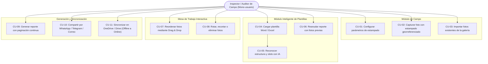

# Historias de Usuario y Casos de Uso del Sistema

**Proyecto:** Sistema Inteligente de Gestión, Estampado Georreferenciado y Diligenciamiento Automático de Reportes Fotográficos en Plantillas Empresariales  
**Programa:** Especialización en Inteligencia Artificial  
**Documento:** `docs/02_especificacion_requisitos/03_historias_de_usuario_y_casos_de_uso.md`  

---

## 1. Diagrama General de Casos de Uso



---

## 2. Casos de Uso Detallados

### Caso de Uso CU-02: Capturar foto con estampado georreferenciado
- **Actor Principal:** Inspector de Campo.
- **Precondiciones:**
  1. La aplicación tiene permisos de cámara y ubicación concedidos.
  2. Existe un proyecto seleccionado o activo.
- **Flujo Principal:**
  1. El usuario abre el visor de cámara de la aplicación.
  2. La pantalla muestra en tiempo real la previsualización del encuadre y una superposición (*overlay*) con la fecha actual, las coordenadas GPS (si el sensor está activo), el mini-mapa y el logo de la empresa.
  3. El usuario puede pulsar el botón de configuración rápida para cambiar la transparencia de fondo, agregar un texto corto descriptivo o alternar el formato de coordenadas (Decimal, DMS, UTM).
  4. El usuario presiona el disparador de la cámara.
  5. El motor de procesamiento (*Watermarking Engine*) fusiona la imagen con las capas de metadatos en menos de 300 ms.
  6. La imagen estampada se almacena en el almacenamiento interno del dispositivo y se crea el registro correspondiente en la base de datos local SQLite.
- **Flujos Alternativos:**
  - *GPS sin señal o desactivado:* El sistema muestra la advertencia en pantalla; si está desactivado por elección del usuario, estampa la fecha, logo y notas omitiendo las coordenadas y el mapa.

---

### Caso de Uso CU-05: Reconocimiento de Plantilla con IA y Paginación Dinámica
- **Actor Principal:** Inspector de Campo / Sistema de IA.
- **Precondiciones:** El usuario ha cargado un archivo `.docx` o `.xlsx` como plantilla del proyecto.
- **Flujo Principal:**
  1. El usuario selecciona la opción "Procesar Plantilla con IA".
  2. El sistema renderiza la primera página/hoja del documento a una representación de imagen en memoria.
  3. El modelo de Inteligencia Artificial (DLA) procesa la imagen e identifica los recuadros delimitadores de las fotografías (`photo_slots`), los pies de foto (`caption_slots`) y la capacidad de la hoja (ejemplo: 4 fotos por hoja).
  4. El sistema mapea las coordenadas de visión con las celdas OpenXML del documento original.
  5. El sistema presenta al usuario una vista previa destacando visualmente dónde se insertarán las fotografías detectadas.
  6. El usuario confirma la selección de fotos (ej. 14 fotos).
  7. El motor de inyección detecta que 14 fotos superan las 4 de la plantilla base.
  8. El motor clona dinámicamente la estructura de la página 3 veces más, generando un reporte de 4 páginas con 14 fotos ajustadas y numeradas secuencialmente.

---

### Caso de Uso CU-06: Reanudación de reporte con fotos previas
- **Actor Principal:** Inspector de Campo.
- **Precondiciones:** El usuario carga un archivo `.docx` o `.xlsx` que ya contiene fotos incrustadas manualmente o de una sesión anterior.
- **Flujo Principal:**
  1. El usuario importa el archivo con el botón "Continuar reporte existente".
  2. El modelo de IA y el analizador OpenXML inspeccionan el documento e identifican que, de 8 recuadros disponibles en las primeras 2 páginas, los primeros 5 ya contienen imágenes.
  3. El sistema notifica al usuario: *"Se detectaron 5 fotos existentes. El cargue continuará desde el recuadro 6"*.
  4. El usuario selecciona 10 fotos nuevas para agregar.
  5. El sistema inyecta las 3 fotos siguientes en los espacios libres restantes y clona automáticamente nuevas páginas para las 7 fotos restantes.
  6. Ninguna fotografía previa es sobreescrita de forma involuntaria durante el cargue masivo.
  7. En la Mesa de Trabajo, el usuario visualiza tanto las 5 fotos preexistentes como las 10 fotos nuevas, pudiendo reordenarlas libremente por *Drag & Drop*, rotarlas, recortarlas o eliminar cualquiera de las fotos preexistentes si ya no es necesaria.

---

### Caso de Uso CU-07: Reorganización Ágil en Mesa de Trabajo (Drag & Drop)
- **Actor Principal:** Inspector de Campo.
- **Precondiciones:** Las fotos han sido asignadas a los recuadros de la plantilla en la mesa de trabajo.
- **Flujo Principal:**
  1. El usuario entra a la "Mesa de Trabajo" (*Canvas* interactivo).
  2. Las fotos se muestran ordenadas por página en una cuadrícula idéntica a la plantilla.
  3. El usuario mantiene presionada una fotografía y la arrastra hacia otra posición (o selecciona varias fotos simultáneamente y las traslada a otra página).
  4. Las posiciones se intercambian inmediatamente con una animación fluida.
  5. El usuario pulsa sobre una foto específica para rotarla 90° o recortar el encuadre.
  6. Los pies de foto y numeraciones correlativas se recalculan automáticamente.

---

### Caso de Uso CU-11: Sincronización en la Nube (Offline a Online)
- **Actor Principal:** Inspector de Campo / Worker de Sincronización.
- **Flujo Principal:**
  1. El usuario genera su reporte y pulsa "Guardar en OneDrive/Drive" mientras se encuentra en una zona sin cobertura celular.
  2. La aplicación guarda el documento localmente y añade la tarea a la cola de sincronización con estado `EN_ESPERA_RED`.
  3. El usuario sale de la zona rural y el dispositivo recupera señal 4G/Wi-Fi.
  4. El receptor de conectividad del sistema operativo despierta el despachador en segundo plano (*Background Sync Worker*).
  5. El despachador toma la tarea de la cola, autentica contra Microsoft Graph o Google Drive mediante el token seguro y sube el archivo al directorio del proyecto correspondiente.
  6. Al completar la carga, el sistema notifica al usuario: *"Reporte sincronizado con éxito en OneDrive"*.

---

## 3. Historias de Usuario con Criterios de Aceptación (Gherkin)

### HU-01: Configuración visual de estampado en vivo
> **Como** inspector de obras en campo,  
> **quiero** previsualizar y ajustar los metadatos estampados (fecha, coordenadas, mapa, logo y transparencia de fondo),  
> **para** cumplir con los estándares de evidencia exigidos por mi cliente sin necesidad de editar las fotos posteriormente.

```gherkin
Escenario: Configurar transparencia y coordenadas en estampado
  Dado que estoy en la pantalla de la cámara con el panel de configuración abierto
  Cuando ajusto el control deslizante de transparencia al 60%
  Y selecciono el formato de coordenadas "UTM"
  Y activo la casilla de "Mini-mapa de Google"
  Entonces la vista previa de la cámara actualiza inmediatamente el recuadro inferior
  Y al capturar la fotografía, el archivo resultante tiene los metadatos fusionados exactamente como en la vista previa.
```

---

### HU-02: Detección y clonación de páginas de plantilla por IA
> **Como** auditor técnico,  
> **quiero** cargar la plantilla en Word de mi empresa y que el sistema detecte automáticamente dónde van las fotos y duplique las hojas necesarias,  
> **para** no perder horas copiando y pegando tablas y desconfigurando los márgenes manualmente.

```gherkin
Escenario: Carga masiva con excedente de fotos en plantilla de 4 fotos
  Dado que cargo una plantilla .docx con una tabla de 4 recuadros fotográficos por página
  Cuando selecciono 10 fotografías para inyectar en el reporte
  Entonces la IA reconoce los 4 recuadros de la plantilla base
  Y el sistema genera un documento resultante de 3 páginas
  Y las páginas 2 y 3 tienen exactamente el mismo formato, logos y encabezados que la página original.
```

---

### HU-03: Continuación de reporte semidiligenciado
> **Como** usuario que comenzó a armar un reporte manualmente en Excel,  
> **quiero** subir el archivo a la aplicación para que continúe llenando desde la última foto vacía,  
> **para** ahorrar tiempo y aprovechar las fotos tomadas en campo sin empezar desde cero.

```gherkin
Escenario: Inyección en formato Excel con fotos existentes
  Dado que subo un archivo .xlsx que ya tiene 3 celdas con fotos incrustadas de 6 posibles
  Cuando selecciono 5 fotografías nuevas en la aplicación
  Entonces el sistema detecta que los primeros 3 espacios están ocupados
  Y ubica las siguientes 3 fotos en los espacios 4, 5 y 6
  Y añade una nueva sección con las 2 fotos restantes sin borrar las 3 fotos iniciales.
```
