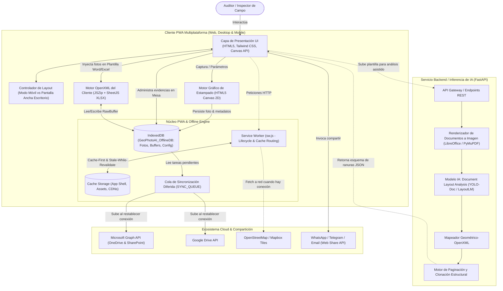
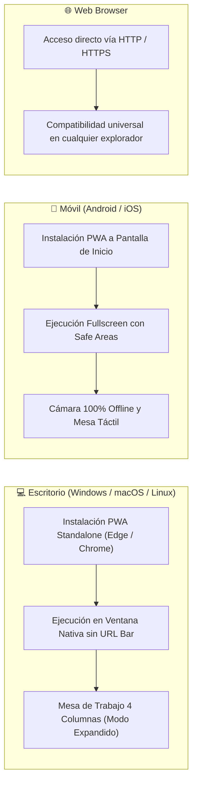

# Arquitectura Global del Sistema

**Proyecto:** Sistema Inteligente de Gestión, Estampado Georreferenciado y Diligenciamiento Automático de Reportes Fotográficos en Plantillas Empresariales  
**Programa:** Especialización en Inteligencia Artificial  
**Modalidad Tecnológica:** Progressive Web App (PWA) Multiplataforma (Web, Escritorio y Móvil) Offline-First  
**Documento:** `docs/03_arquitectura_y_diseno/01_arquitectura_del_sistema.md`  

---

## 1. Visión General de la Arquitectura (Diagrama C4 PWA)

El sistema está diseñado bajo un paradigma **Progressive Web App (PWA) Multiplataforma con arquitectura 100% Offline-First**. Esto permite que un único núcleo de código se ejecute de forma nativa en navegadores web, computadores de escritorio (Windows, macOS, Linux) y dispositivos móviles (Android, iOS), manteniendo autonomía total sin conexión a internet y ofreciendo capacidades avanzadas de análisis de documentos mediante Inteligencia Artificial.

---

## 2. Descripción de Componentes del Sistema

### 2.1. Capa Cliente PWA Multiplataforma
- **UI Responsiva y Mesa de Trabajo:** Interfaz reactiva adaptable mediante Tailwind CSS. Dispone de un gestor de layout que permite alternar entre:
  - **Modo Marco Móvil:** Óptimo para pantallas de teléfonos y simuladores de campo verticales.
  - **Modo Pantalla Ancha Expandido (`desktop-expanded`):** Optimizado para monitores de escritorio con cuadrícula de 4 columnas, maximizando la visibilidad de auditorías complejas.
- **Motor Gráfico de Estampado (*Watermarking Engine*):** Módulo basado en Canvas 2D acelerado por GPU que sobreimprime en microsegundos las capas de texto con antialiasing, transparencias alfa configurables, logotipos y el mini-mapa geográfico.
- **Service Worker (`sw.js`):** Script interceptor de red registrado en el navegador con alcance total del origen (`scope: '/'`). Administra:
  - *Pre-caching:* Almacenamiento inmediato de todos los archivos del App Shell durante la fase `install`.
  - *Runtime-caching:* Manejo de librerías externas (Tailwind, Phosphor Icons, Leaflet) bajo la estrategia *Stale-While-Revalidate*.
  - *Offline Fallback:* Garantía de que cualquier navegación o recarga sin red devuelva el App Shell funcional.
- **Almacén Persistente IndexedDB (`OfflineStore`):** Base de datos relacional/objeto local de alta capacidad en el navegador (`GeoPhotoAI_OfflineDB`). A diferencia del límite de 5 MB de `localStorage`, IndexedDB admite cientos de megabytes para almacenar colecciones de fotos en alta resolución y el archivo binario completo del documento de Word/Excel (`state.template.rawBuffer`).
- **Motor OpenXML en el Cliente:** Procesamiento directo en el navegador utilizando **JSZip** y **SheetJS (xlsx)**. Permite descomprimir documentos `.docx`, inspeccionar `word/document.xml`, proteger membretes en `header*.xml`/`footer*.xml`, mapear ranuras fotográficas y serializar el archivo final sin depender obligatoriamente de un servidor remoto.

### 2.2. Capa Backend / Motor de Inteligencia Artificial (Microservicio FastAPI)
- **Renderizador de Documentos:** Convierte el archivo `.docx` o `.xlsx` subido por el usuario en páginas/hojas representadas como imágenes rasterizadas de alta fidelidad (150-200 DPI).
- **Modelo de Inferencia DLA (Document Layout Analysis):** Red neuronal convolucional / Transformer de visión (YOLO-Doc / LayoutLM) entrenada para detectar las cajas delimitadoras (*bounding boxes*) de los recuadros fotográficos, pies de foto y bloques institucionales.
- **Mapeador Geométrico OpenXML:** Algoritmo de intersección que cruza las coordenadas en píxeles detectadas por la IA con las coordenadas métricas de las tablas y celdas del archivo OpenXML original.
- **Motor de Paginación y Clonación Dinámica:** Servicio que replica las secciones del árbol XML tantas veces como sea necesario según el volumen de fotos seleccionadas por el usuario.

### 2.3. Capa de Integraciones Externas y Sincronización
- **APIs de Almacenamiento Cloud:** Integración con Microsoft Graph API y Google Drive API mediante flujo OAuth 2.0 PKCE, permitiendo guardar documentos en carpetas corporativas o sitios de SharePoint.
- **Web Share API y Hojas de Compartición:** Interacción con los canales de mensajería del sistema operativo (WhatsApp, Telegram, Correo) sin dependencias de librerías privativas.

---

## 3. Topología de Despliegue y Ejecución Multiplataforma

### Ventajas de la Transformación a PWA:
1. **Un Solo Código Fuente (*Single Codebase*):** Todo el desarrollo de interfaz, lógica de negocio y procesamiento de formatos reside en HTML5/CSS/JS modular, eliminando el coste de mantener apps nativas separadas para Android (Java/Kotlin), iOS (Swift) y Windows (.NET/WPF).
2. **Capacidad 100% Offline Garantizada:** Gracias al Service Worker y a IndexedDB, el sistema es completamente autónomo en zonas rurales o de difícil cobertura sin conexión a internet.
3. **Distribución Inmediata sin Burocracia de App Stores:** Los usuarios pueden instalar la herramienta instantáneamente desde el navegador corporativo sin esperar aprobaciones en Google Play o Apple App Store.
