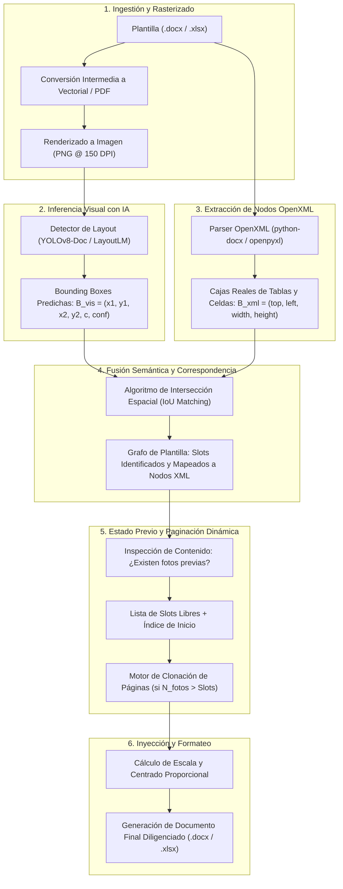
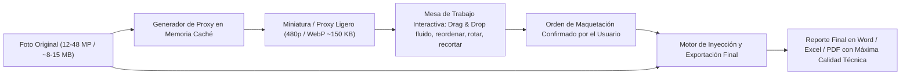

# Componente de Inteligencia Artificial: Reconocimiento y Diligenciamiento de Plantillas

**Proyecto:** Sistema Inteligente de Gestión, Estampado Georreferenciado y Diligenciamiento Automático de Reportes Fotográficos en Plantillas Empresariales  
**Programa:** Especialización en Inteligencia Artificial  
**Documento:** `docs/03_arquitectura_y_diseno/02_componente_ia_reconocimiento_plantillas.md`  

---

## 1. Definición Formal del Problema de IA

El objetivo del componente de IA es resolver la tarea de **Document Layout Analysis (DLA) y Semantic Slot Filling** sobre documentos ofimáticos no estructurados o semiestructurados (`.docx` y `.xlsx`).

Dado un documento plantilla de entrada $D$, el sistema debe:
1. Detectar el conjunto de regiones espaciales $S = \{s_1, s_2, \dots, s_k\}$ destinadas a contener fotografías (*photo slots*).
2. Asociar cada región fotográfica $s_i$ con su respectivo pie de foto o descripción $c_i \in C$ (*caption slots*).
3. Determinar la topología repetitiva de la página (capacidad $K$ de fotos por hoja).
4. Determinar el estado de ocupación de cada recuadro $O(s_i) \in \{\text{VACÍO}, \text{OCUPADO}\}$ para permitir la continuación de reportes previos.

---

## 2. Pipeline Integral de Reconocimiento y Diligenciamiento



---

## 3. Detalle Técnico de las Fases del Pipeline

### 3.1. Fase 1: Ingestión y Renderizado de Alta Fidelidad
Para aplicar visión por computadora a formatos como Word y Excel, el archivo se convierte temporalmente a una representación paginada fiel usando LibreOffice headless o PyMuPDF:
$$\text{Páginas} = \{I_1, I_2, \dots, I_m\}, \quad I_j \in \mathbb{R}^{H \times W \times 3}, \quad \text{DPI} = 150$$
Esto garantiza que la disposición visual evaluada por la red neuronal coincida exactamente con la visualización que tendría un ser humano al imprimir el documento.

---

### 3.2. Fase 2: Modelo de Visión por Computadora (YOLOv8-Doc)
Se implementa una red neuronal basada en arquitectura YOLOv8 optimizada para documentos de texto y tablas (*fine-tuned* con datasets de documentos administrativos):

#### Taxonomía de Clases de Detección:
1. `class_0: photo_evidence_slot`: Recuadros o celdas de tabla en el **espacio de trabajo** destinados exclusivamente a fotografías de evidencia.
2. `class_1: caption_slot`: Celdas de texto asociadas para rótulo ("Foto N°", fecha, descripción técnica).
3. `class_2: header_zone`: Región superior del documento que contiene membretes, títulos y códigos de calidad.
4. `class_3: logo_corporate_slot`: **Zona de Logotipo Corporativo Protegida**. La IA reconoce estas áreas (por posición en cabecera/pie, dimensiones típicas y metadatos) y las clasifica como **INMUTABLES**. Jamás son tratadas como espacio disponible ni son sobreescritas durante el cargue masivo.

---

### 3.3. Delimitación del Espacio de Trabajo de Evidencias (*Evidence Workspace*)
Para evitar falsos positivos con membretes o logos:
1. El analizador segmenta verticalmente la página en tres zonas:
   - **Zona de Cabecera ($\text{Header Area}$):** Contiene logos corporativos, nombres de proyecto y tablas de codificación. Es marcada como **ÁREA RESTRINGIDA / PRESERVADA**.
   - **Espacio de Trabajo de Evidencias ($\text{Workspace Body Area}$):** Zona central donde se ubican las matrices o tablas de registro fotográfico. La búsqueda de slots y clonación opera **únicamente** sobre esta región.
   - **Zona de Pie de Página ($\text{Footer Area}$):** Paginación institucional y firmas de responsabilidad.

---

### 3.4. Fase 3 y 4: Mapeo Geométrico entre Visión y Nodos OpenXML
La inferencia visual genera cajas en coordenadas de imagen $(\hat{x}_1, \hat{y}_1, \hat{x}_2, \hat{y}_2)$ en píxeles. El parser de OpenXML extrae la jerarquía de celdas de Word (`<w:tc>`) o de Excel (`<c>`) y sus dimensiones métricas en EMUs o puntos.

Para cada caja detectada por la IA $\hat{B}_i$ y cada celda candidata de OpenXML $C_j$:
$$\text{IoU}(\hat{B}_i, C_j) = \frac{\text{Área}(\hat{B}_i \cap C_j)}{\text{Área}(\hat{B}_i \cup C_j)}$$
Se aplica el algoritmo húngaro (*Hungarian Matching Algorithm*) para asociar de forma biyectiva cada predicción de la IA con el puntero exacto del nodo XML en memoria.

---

### 3.5. Fase 5: Detección de Estado Previo (Continuación de Reportes Semidiligenciados)
Para cumplir con el requerimiento de reanudar reportes incompletos respetando lo preexistente:
1. El sistema inspecciona los nodos hijos de cada celda `<w:tc>` ubicada dentro del **Espacio de Trabajo de Evidencias**.
2. **Discriminación de Logos vs. Evidencias Previas:**
   - Si la imagen se encuentra dentro de la `Header Area` o asociada a un `logo_corporate_slot`, se etiqueta como `LOGO_PRESERVADO` (se mantiene intacto).
   - Si la imagen se encuentra en una celda del `Workspace Body Area`, se clasifica como `EVIDENCIA_PREVIA_OCUPADA`.
3. **Cálculo del Índice de Reanudación y Protección Inicial:**
   - Los slots ocupados por fotos preexistentes se protegen del autollenado para evitar sobreescritura accidental.
   - El sistema ubica el primer slot libre disponible:
     $$k_{\text{inicio}} = \min \{ i \mid \text{Estado}(s_i) = \text{DISPONIBLE} \}$$
   - Las nuevas fotos del usuario se inyectan a partir de $k_{\text{inicio}}$. Si el número de fotos nuevas excede los espacios libres de la hoja, se activa la clonación dinámica de páginas.
4. **Ciclo de Edición Total sobre Fotos Preexistentes en la Mesa de Trabajo:**
   - Una vez inyectadas las fotos nuevas, el sistema extrae las referencias de las fotos preexistentes y las disponibiliza en la **Mesa de Trabajo Interactiva** como entidades editables.
   - El usuario tiene control absoluto para:
     - **Reordenarlas:** Mover una foto preexistente a una página diferente o intercambiarla con una foto recién tomada mediante *Drag & Drop*.
     - **Ajustarlas:** Corregir rotación (90°), aplicar recorte (*crop*) o reescalado.
     - **Eliminarlas:** Si el usuario decide descartar una foto preexistente, el sistema la remueve del reporte y recorre las fotos consecutivas para consolidar la estructura sin huecos.

---

### 3.6. Arquitectura de Doble Resolución (Proxy en Edición vs. Hi-Res en Exportación)
Para asegurar que la interacción táctil de organización (Drag & Drop, rotación y recorte) sea instantánea y no sobrecargue la memoria RAM del teléfono móvil al manejar decenas de fotos de 12-48 MP:



1. **Modo Edición / Maquetación:** Se utilizan representaciones proxy de baja resolución y compresión optimizada en memoria. Permite manipular 50+ fotos a 60 FPS sin retraso.
2. **Modo Exportación Final:** El motor recupera los archivos maestros en alta resolución y aplica las transformaciones registradas (rotación, recorte, escala calculada) directamente sobre el documento final `.docx` o `.xlsx`.

### 3.7. Fase 6: Ajuste Dinámico al Contenedor e Inmutabilidad del Formato
El principio rector del sistema es la **no alteración del formato de la empresa**: el software **nunca impone dimensiones fijas o arbitrarias** a las fotografías. La geometría de cada imagen está estrictamente subordinada al diseño preexistente de la plantilla que el usuario cargó:

1. **Extracción Dinámica de Dimensiones del Contenedor ($W_{\text{celda}}, H_{\text{celda}}$):**
   - El analizador OpenXML inspecciona la celda de Word (`<w:tc>`) o el anclaje de Excel (`<xdr:twoCellAnchor>`) y extrae sus medidas métricas reales exactamente como fueron creadas por la empresa:
     $$\text{Ancho en EMUs} = \text{nodo.width}, \quad \text{Alto en EMUs} = \text{nodo.height}$$
2. **Ajuste Proporcional Inteligente (*Aspect Ratio Smart Fit*):**
   - Sean $(W_f, H_f)$ las dimensiones de la foto capturada en campo.
   - El factor de escala se calcula para que la fotografía ocupe el máximo espacio de la celda sin deformarse:
     $$s = \min\left( \frac{W_{\text{celda}}}{W_f}, \frac{H_{\text{celda}}}{H_f} \right)$$
   - Las dimensiones inyectadas son $W_{\text{final}} = W_f \cdot s$ y $H_{\text{final}} = H_f \cdot s$, centrando la imagen dentro del recuadro con márgenes de compensación:
     $$\Delta x = \frac{W_{\text{celda}} - W_{\text{final}}}{2}, \quad \Delta y = \frac{H_{\text{celda}} - H_{\text{final}}}{2}$$
3. **Preservación Total de la Estructura Original:**
   - Se bloquea la propiedad de autoajuste de tabla (`<w:cantSplit/>` y anchos fijos de celda) para garantizar que la foto **jamás ensanche una columna, estire una fila ni desplace los encabezados o firmas de la empresa**.

---

### 3.6. Fase 7: Paginación Dinámica y Clonación de Estructura OpenXML
Cuando el número de fotos a insertar $N_{\text{fotos}}$ supera la capacidad disponible en la plantilla $K$:

```python
# Algoritmo de Clonación Dinámica (Representación Conceptual)
def clonar_paginacion_word(doc, template_table_node, fotos_restantes):
  k_capacidad = len(template_table_node.photo_slots)

  while len(fotos_restantes) > 0:
    # 1. Insertar salto de página en el árbol XML
    doc.add_page_break()

    # 2. Clonar profundamente el sub-árbol XML de la tabla plantilla
    nueva_tabla = deepcopy(template_table_node)

    # 3. Limpiar contenidos previos de slots si existían
    for slot in nueva_tabla.photo_slots:
      slot.clear_contents()

    # 4. Inyectar lote de fotos en la nueva página
    lote = fotos_restantes[:k_capacidad]
    inyectar_lote(nueva_tabla, lote)
    fotos_restantes = fotos_restantes[k_capacidad:]

    # 5. Insertar la nueva tabla en el cuerpo del documento
    doc.body.append(nueva_tabla)
```

En Microsoft Excel (`.xlsx`), el proceso es análogo: se copia el rango de filas y celdas correspondientes al bloque de página hacia abajo, ajustando las referencias de las celdas y creando los anclajes de dibujo correspondientes en `drawing.xml`.
