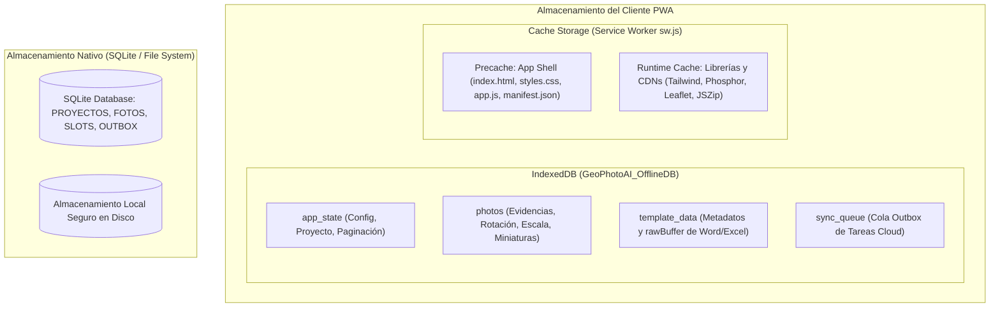
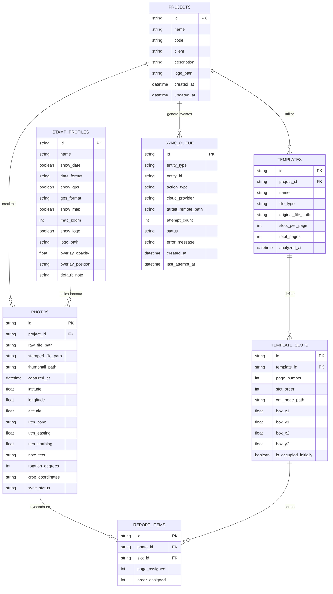
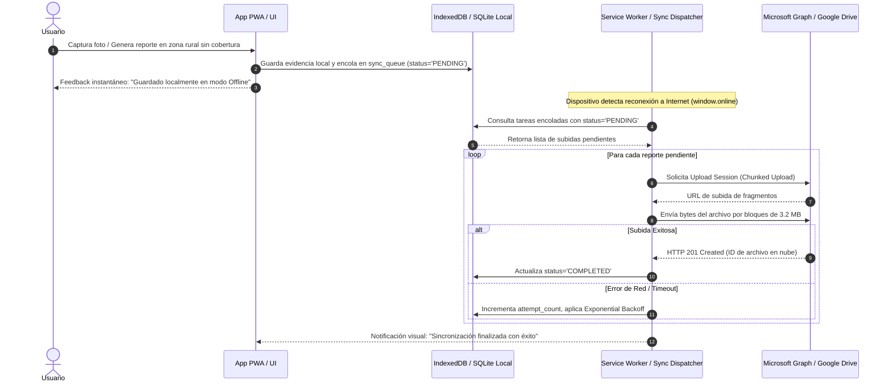

# Diseño de Datos, Persistencia Local Offline y Sincronización Cloud

**Proyecto:** Sistema Inteligente de Gestión, Estampado Georreferenciado y Diligenciamiento Automático de Reportes Fotográficos en Plantillas Empresariales  
**Programa:** Especialización en Inteligencia Artificial  
**Modalidad Tecnológica:** Progressive Web App (PWA) Multiplataforma Offline-First  
**Documento:** `docs/03_arquitectura_y_diseno/03_diseno_datos_y_sincronizacion.md`  

---

## 1. Estrategia de Persistencia Dual Offline-First

Para soportar el funcionamiento 100% autónomo sin conexión a internet en Web, Escritorio y Móvil, el sistema implementa una arquitectura de almacenamiento persistente en capas:



---

## 2. Esquema de Datos en IndexedDB (`GeoPhotoAI_OfflineDB`)

IndexedDB es el motor de persistencia estándar de la PWA. Permite almacenar grandes volúmenes de datos binarios estructurados (`ArrayBuffer`, `Blob`, `DataURL`) que exceden ampliamente las capacidades y límites de `localStorage` (5 MB):

### 2.1. Object Stores de la PWA

| Object Store | Clave Primaria (`keyPath`) | Tipo de Contenido | Propósito |
| :--- | :--- | :--- | :--- |
| `app_state` | `key` (`string`) | Objeto JSON | Guarda parámetros globales: configuración de estampado (`config`), metadatos del proyecto activo (`currentProject`) y página actual (`currentPage`). |
| `photos` | `id` (`string`, ej: `'FOTO-001'`) | Objeto Foto Completo | Guarda cada fotografía con su imagen base64/blob, título correlativo, nota, rotación (0°, 90°, 180°, 270°), escala de encuadre, coordenadas GPS y procedencia. |
| `template_data` | `id` (`string`, ej: `'active_template'`) | Objeto Binario y Metadatos | Guarda el buffer binario original de la plantilla (`rawBuffer: ArrayBuffer`), nombre, tipo (`word`/`excel`), número de fotos por página y título detectado. |
| `sync_queue` | `id` (`autoIncrement` o UUID) | Tarea de Sincronización | Encola peticiones de subida a nubes corporativas que se generaron sin conexión a internet. |

### 2.2. Flujo de Auto-Guardado Reactivo (`scheduleOfflineSave`)
Para evitar sobrecarga de I/O en operaciones rápidas (como arrastrar fotos o rotar imágenes consecutivamente), la PWA implementa un mecanismo con técnica *debounce* (400 ms):
```javascript
let offlineSaveTimer = null;
function scheduleOfflineSave() {
  clearTimeout(offlineSaveTimer);
  offlineSaveTimer = setTimeout(() => {
    OfflineStore.saveState(state).catch(err => console.warn(err));
  }, 400);
}
```
Este método se invoca automáticamente ante cualquier mutación de estado: captura de foto, importación de galería, recorte, rotación, reordenamiento por arrastre, eliminación, movimiento entre hojas y carga de una nueva plantilla.

---

## 3. Esquema Relacional de Base de Datos Local (SQLite para Despliegues Nativos)

Para compilaciones móviles nativas empaquetadas (Capacitor / React Native / Flutter), la persistencia utiliza SQLite:



---

## 4. Arquitectura del Motor de Sincronización (Offline-to-Online)



---

## 5. Conectores e Integración Cloud

### 5.1. Microsoft OneDrive y SharePoint (Microsoft Graph API)
- **Autenticación:** OAuth 2.0 PKCE.
- **Alcances requeridos:** `Files.ReadWrite`, `offline_access`.
- **Estrategia de Carga:**
  - Archivos menores a 4 MB: Endpoint directo `PUT /me/drive/items/{parent-id}:/{filename}:/content`.
  - Archivos grandes (> 4 MB): Sesión de carga fragmentada `POST /me/drive/items/{parent-id}:/{filename}:/createUploadSession` con envío por bloques de 3.2 MB, permitiendo reanudar la carga ante pérdidas de señal celular.

### 5.2. Google Drive (Google Drive API v3)
- **Autenticación:** Google Sign-In SDK con alcance `https://www.googleapis.com/auth/drive.file`.
- **Estrategia de Carga:** *Resumable Upload* con cabeceras `X-Upload-Content-Type` y lectura de respuesta `308 Resume Incomplete` para tolerar interrupciones de conectividad en carretera o campo.
