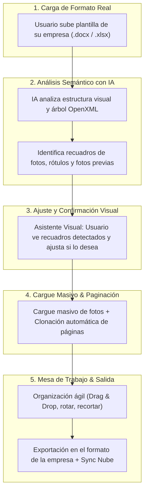

# Módulo de Gestión, Carga y Ajuste Interactivo de Formatos con IA

**Proyecto:** Sistema Inteligente de Gestión, Estampado Georreferenciado y Diligenciamiento Automático de Reportes Fotográficos en Plantillas Empresariales  
**Programa:** Especialización en Inteligencia Artificial  
**Documento:** `docs/03_arquitectura_y_diseno/05_modulo_gestion_y_ajuste_de_formatos.md`  

---

## 1. El Concepto Central: "Tu Propia Plantilla Empresarial, Cero Rigidez"

A diferencia de aplicaciones como *TimeMark* o *Timestamp Camera* —las cuales obligan a la empresa a adaptarse a sus reportes predeterminados o a realizar la maquetación a mano en una computadora—, el núcleo innovador de este proyecto es la **capacidad de admitir, comprender, ajustar y diligenciar cualquier formato corporativo que el usuario suba en Microsoft Word (`.docx`) o Microsoft Excel (`.xlsx`)**.



---

## 2. Flujo Detallado Paso a Paso

### 2.1. Carga del Formato Institucional
- El usuario puede importar su formato directamente desde:
  - El almacenamiento local del teléfono o tarjeta SD.
  - Sus carpetas sincronizadas en **OneDrive, SharePoint o Google Drive**.
- El sistema admite formatos de procesador de texto (`.docx`, `.doc`) y hojas de cálculo (`.xlsx`, `.xls`).
- La plantilla queda guardada en la base de datos local SQLite y vinculada al **Proyecto de Inspección** correspondiente, de modo que el usuario no tiene que volver a cargarla para inspecciones futuras.

---

### 2.2. Detección Inteligente con IA (Document Layout Analysis)
Una vez cargado el archivo, el motor de Inteligencia Artificial ejecuta el análisis estructural:
1. **Delimitación del Espacio de Trabajo de Evidencias (*Evidence Workspace*):**
   - El sistema analiza la página y separa el **Encabezado/Membrete** del **Cuerpo de Evidencias**.
   - **Omisión Estricta de Logos Corporativos:** Los recuadros que ya contienen logotipos o membretes de la empresa son clasificados como **ÁREAS INMUTABLES**. La IA los protege para que **jamás sean reemplazados ni sobreescritos** con fotos de la inspección.
2. **Detección de Recuadros Fotográficos (`photo_slots`):** Identifica las dimensiones y coordenadas de cada espacio destinado a imágenes dentro del cuerpo de la tabla.
3. **Detección de Pies de Foto (`caption_slots`):** Ubica las casillas de descripción, fechas y numeraciones consecutivas vinculadas a cada foto.
4. **Cálculo de Capacidad por Hoja:** Determina la densidad del formato (por ejemplo: 2 fotos por página vertical, 4 fotos en cuadrícula $2 \times 2$, o 6 fotos por página).
5. **Inspección de Estado Previo:** Revisa si el documento ya cuenta con imágenes incrustadas previamente en el espacio de trabajo (caso en el que el usuario ya venía trabajando en el reporte y desea continuarlo en la app).

---

### 2.3. Asistente Visual de Ajuste y Calibración (Human-in-the-Loop)
Para garantizar 100% de fiabilidad ante formatos complejos, el sistema no solo realiza la predicción automática, sino que le brinda al usuario una **pantalla interactiva de verificación y ajuste**:

```
+-------------------------------------------------------------+
|  <- Calibración de Formato: Formato_Auditoria.docx [Guardar]|
+-------------------------------------------------------------+
|  VISTA PREVIA DE LA PLANTILLA RECONOCIDA:                   |
|                                                             |
|  +-------------------------------------------------------+  |
|  |  [ LOGO EMPRESA ]    REPORTE DE INSPECCIÓN CIVIL      |  |
|  |  Contrato: CT-2026   Fecha: 09/Oct/2026               |  |
|  |                                                       |  |
|  |  +---------------------+   +---------------------+    |  |
|  |  | [ Slot #1: DETECTADO] |   | [ Slot #2: DETECTADO] |    |  |
|  |  +---------------------+   +---------------------+    |  |
|  |  | Pie de Foto #1      |   | Pie de Foto #2      |    |  |
|  |                                                       |  |
|  |  +---------------------+   +---------------------+    |  |
|  |  | [ Slot #3: DETECTADO] |   | [ Slot #4: DETECTADO] |    |  |
|  |  +---------------------+   +---------------------+    |  |
|  |  | Pie de Foto #3      |   | Pie de Foto #4      |    |  |
|  +-------------------------------------------------------+  |
|                                                             |
|  IA RESUMEN:                                                |
|  - 4 Recuadros detectados por hoja                          |
|  - Capacidad: 4 fotos/página                                |
|                                                             |
|  HERRAMIENTAS DE AJUSTE RÁPIDO:                             |
|  [ ➕ Añadir Recuadro ]  [ ✏ Reordenar Secuencia (1->2->3->4) ]|
|  [ ✔ Confirmar y Usar Formato ]                             |
+-------------------------------------------------------------+
```

- **Ajuste Manual Opcional:** Si una empresa maneja una celda muy particular que la IA no etiquetó con máxima certeza, el usuario simplemente toca la celda en pantalla para marcarla como `Recuadro Fotográfico` o `Pie de Foto`.
- **Memorización de Esquema:** Una vez calibrada la plantilla, el sistema guarda las reglas de esa plantilla para que **nunca más deba ser calibrada**.

### 2.4. Cargue Masivo y Adaptación Dinámica al Formato (Sin Alterar el Documento)
- El usuario selecciona el grupo de fotografías que desea incluir en el informe (ejemplo: 22 fotografías).
- **Adaptación Estricta al Formato Compartido:**
  1. **Sin Medidas Fijas Arbitrarias:** El sistema no utiliza medidas predeterminadas; lee las dimensiones exactas de la celda o recuadro que ya tiene la plantilla de la empresa.
  2. **Subordinación Total al Formato:** La fotografía es la que se amolda y adapta a la celda del formato, **jamás al revés**. La tabla, anchos de columna, altos de fila, bordes y membretes de la empresa permanecen **100% inalterados**.
  3. **Ajuste Proporcional Inteligente (*Smart Fit*):** El motor escala la foto para llenar el espacio disponible de la celda respetando su proporción, aplicando centrado milimétrico para que no exista deformación visual ni descuadre de márgenes.

---

### 2.5. Paginación Dinámica y Clonación Continua
¿Qué sucede cuando el usuario tiene 22 fotos y el formato de la empresa solo tiene espacio para 4 fotos por hoja?
- **El problema en otras apps:** El usuario tendría que abrir Word en su PC, copiar y pegar la tabla manualmente 5 veces, rompiendo numeraciones y encabezados.
- **La solución de nuestro proyecto:** El motor OpenXML detecta que faltan 18 espacios. Automáticamente:
  1. Inserta saltos de página idénticos (`<w:br w:type="page"/>`).
  2. Clona la estructura de la tabla, encabezados y estilos corporativos.
  3. Crea 5 páginas adicionales con la misma diagramación.
  4. Numera consecutivamente las fotos (Foto 1 a Foto 22).

---

### 2.6. Reanudación de Formatos ya Iniciados y Edición Total de Fotos Previas
Un caso de uso fundamental en campo:
> *El ingeniero ya había empezado a hacer el reporte a mano en su computadora, metió 3 fotos y se fue a campo. En campo toma 10 fotos más y no quiere empezar de cero.*

1. El usuario sube el archivo `.docx` o `.xlsx` semi-diligenciado.
2. El sistema analiza el archivo y detecta que los primeros 3 recuadros ya contienen imágenes.
3. El sistema marca esos 3 recuadros como **PROTEGIDOS CONTRA SOBREESCRITURA AUTOMÁTICA** para que el cargue masivo no las pise.
4. El cargue de las 10 fotos nuevas inicia automáticamente en el **Recuadro #4** y clona nuevas páginas para las fotos excedentes.
5. **Control Total en la Mesa de Trabajo (Editar, Ajustar, Reordenar y Eliminar):**
   - Una vez consolidado el reporte, las 3 fotos preexistentes aparecen en la Mesa de Trabajo junto a las 10 fotos nuevas.
   - El usuario **no está atado a dejarlas tal como estaban**:
     - **Reordenar:** Puede mover la foto previa #1 a la página 3 o poner una foto nueva en el primer lugar mediante *Drag & Drop*.
     - **Ajustar:** Puede rotarlas 90°, cambiar su recorte o alineación.
     - **Eliminar:** Puede borrar cualquiera de las fotos preexistentes si ya no es relevante; el sistema reacomoda las fotos restantes automáticamente para no dejar celdas vacías.

---

### 2.7. Mesa de Trabajo Interactiva (Reorganización Rápida con Modo Proxy)
Una vez cargadas las fotos en el formato, el usuario dispone de un panel visual para maquetar el reporte de manera fluida y táctil:
- **Optimización de Rendimiento (Reducción Temporal de Calidad):**
  - Mover y previsualizar decenas de fotografías de 12 a 48 Megapíxeles simultáneamente puede congelar la memoria RAM del teléfono móvil.
  - Para evitar esto, el sistema genera **representaciones proxy / miniaturas ligeras y comprimidas temporalmente** mientras el usuario organiza su reporte.
  - Esto garantiza que el desplazamiento, el zoom y el intercambio de fotos por **Arrastrar y Soltar (Drag & Drop)** se ejecute de forma instantánea a 60 cuadros por segundo, incluso con 50 o más fotos.
- **Acciones Ágiles en la Mesa de Trabajo:**
  - **Arrastrar y Soltar (Drag & Drop):** Permite cambiar el orden de una foto o mover un grupo de fotos a otra página de forma táctil y reactiva.
  - **Rotar 90°:** Corrige la orientación vertical u horizontal con un solo toque.
  - **Recortar (*Crop* inteligente):** Permite ajustar el encuadre respetando la proporción de la celda de la plantilla.
  - **Eliminar:** Quita fotos innecesarias y el sistema recorre automáticamente las siguientes fotos para no dejar huecos vacíos.
- **Retorno Automático a Alta Calidad (Hi-Res Final):**
  - Una vez el usuario finaliza la organización y pulsa *"Exportar Reporte"*, el motor de ensamblado sustituye los proxies temporales por los **archivos maestros originales en máxima resolución y nitidez**, aplicando las rotaciones y recortes elegidos directamente sobre el documento final (`.docx` / `.xlsx` / `.pdf`).

---

### 2.8. Exportación, Sincronización y Compartición
- **Nomenclatura Inteligente:** Permite nombrar el archivo automáticamente mediante reglas (ejemplo: `INFORME_{PROYECTO}_{FECHA}.docx`).
- **Exportación Fiel:** Genera el archivo en el formato nativo original (`.docx` o `.xlsx`) preservando las macros, fórmulas y estilos de la empresa, además de permitir la exportación a `.pdf`.
- **Sincronización Cloud:** Guarda una copia directamente en la carpeta del proyecto en **Microsoft OneDrive, SharePoint o Google Drive**.
- **Compartición Instantánea:** Envía el archivo generado de inmediato a través de **WhatsApp, Telegram o Correo Corporativo**.
