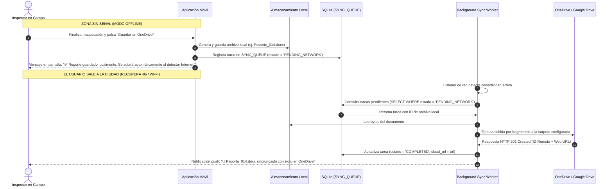

# Módulo de Compartición, Exportación y Sincronización en la Nube

**Proyecto:** Sistema Inteligente de Gestión, Estampado Georreferenciado y Diligenciamiento Automático de Reportes Fotográficos en Plantillas Empresariales  
**Programa:** Especialización en Inteligencia Artificial  
**Documento:** `docs/03_arquitectura_y_diseno/06_modulo_comparticion_exportacion_y_nube.md`  

---

## 1. Visión General del Flujo de Compartición

El módulo de salida garantiza que el documento diligenciado por la Inteligencia Artificial llegue a sus destinatarios finales (clientes, interventorías, gerentes de proyecto) de la forma más rápida y flexible posible, cubriendo tres escenarios fundamentales:
1. **Descarga y Exportación Local:** Guardado directo en el almacenamiento del dispositivo.
2. **Distribución Inmediata por Mensajería y Correo:** Envío directo mediante WhatsApp, Telegram, Gmail o Outlook.
3. **Depósito Corporativo en la Nube:** Subida automatizada a carpetas compartidas en **Microsoft OneDrive, SharePoint o Google Drive**, con soporte para zonas sin conexión (*Offline-First*).

```mermaid
flowchart TD
    Report["Reporte Diligenciado por IA en Memoria"] --> Naming["Motor de Nomenclatura Dinámica"]
    Naming --> FormatSelect{"Selección de Formato de Salida"}
    
    FormatSelect --> F1["Nativo (.docx / .xlsx)"]
    FormatSelect --> F2["Documento Portable (.pdf)"]
    FormatSelect --> F3["Paquete Completo (.zip: Reporte + Fotos Hi-Res)"]

    F1 & F2 & F3 --> Destinos{"Canales de Salida"}

    Destinos --> D1["1. Almacenamiento Local (Descarga en Teléfono)"]
    Destinos --> D2["2. Hoja de Compartir Nativa (WhatsApp / Telegram / Correo)"]
    Destinos --> D3["3. Nube Corporativa (OneDrive / SharePoint / Google Drive)"]

    D3 --> ConnCheck{"¿Hay conexión a Internet?"}
    ConnCheck -->|SÍ (Online)| UploadDirect["Subida directa por API con Upload Session"]
    ConnCheck -->|NO (Offline)| OutboxQueue["Encolar en SYNC_QUEUE de SQLite"]
    OutboxQueue --> NetReturn["Worker detecta retorno de señal 4G/WiFi"]
    NetReturn --> UploadDirect
```

---

## 2. Nomenclatura Inteligente de Archivos

Para evitar que los reportes se guarden con nombres genéricos que generen confusiones o sobreescritura accidental en carpetas compartidas, el sistema implementa un **motor de plantillas de nombres con variables dinámicas**:

### 2.1. Tokens Disponibles para la Máscara
- `{PROYECTO}`: Nombre o código corto del proyecto (ej. `SUBESTACION_SUR`).
- `{FECHA}`: Fecha de la inspección en formato configurable (`AAAAMMDD` o `DDMMAAAA`).
- `{HORA}`: Hora de generación (`HHMMSS`).
- `{INSPECTOR}`: Nombre o identificador del usuario.
- `{CONSECUTIVO}`: Número secuencial del reporte dentro del proyecto (`001`, `002`, etc.).
- `{TIPO_FORMATO}`: Extensión del archivo (`docx`, `xlsx`, `pdf`).

### 2.2. Ejemplo de Nomenclatura Empresarial
```
MÁSCARA:   {PROYECTO}_INF_{FECHA}_N{CONSECUTIVO}.{TIPO_FORMATO}
RESULTADO: SUBESTACION_SUR_INF_20261009_N014.docx
```
El usuario puede aceptar el nombre sugerido automáticamente o editarlo manualmente antes de exportar.

---

## 3. Formatos de Salida y Empaquetado

| Formato | Finalidad Principal | Ventajas Técnicas |
| :--- | :--- | :--- |
| **Microsoft Word (`.docx`)** | Edición posterior y entrega oficial al cliente. | Respeta estrictamente los estilos, membretes, fuentes y márgenes de la empresa. |
| **Microsoft Excel (`.xlsx`)** | Informes cuantitativos, tablas y mediciones. | Cuadrícula milimétrica, anclajes de dibujo y compatibilidad con fórmulas preexistentes. |
| **Adobe PDF (`.pdf`)** | Documento inmutable para firma digital o archivo legal. | No modificable por terceros; se visualiza idéntico en cualquier dispositivo. |
| **Paquete ZIP de Evidencias** | Auditorías técnicas rigurosas y peritajes. | Incluye el archivo diligenciado (`.docx`/`.xlsx`/`.pdf`) + la carpeta con todas las **fotografías originales en alta resolución** y un archivo JSON con los metadatos geodésicos. |

---

## 4. Compartición Rápida a Canales Comunes

El sistema aprovecha la **Hoja de Compartición Nativa (*System Share Sheet*)** del sistema operativo móvil (Android e iOS) para transferir los archivos de forma inmediata:

### 4.1. WhatsApp y WhatsApp Business
- **Envío como Documento (No como Imagen):** El sistema invoca el selector de envío en modo *Documento binario*. Esto es crítico, ya que evita que el algoritmo de compresión de WhatsApp deteriore la calidad de las fotografías o altere el archivo `.docx`/`.xlsx`.
- **Mensaje de Acompañamiento Preformateado:**  
  Junto al archivo, la aplicación pre-redacta un mensaje de texto para el chat:
  > *"Buen día, adjunto el Reporte Fotográfico de Inspección correspondiente al Proyecto: [Nombre del Proyecto], elaborado el [Fecha]. Archivo: [NombreArchivo.docx]"*

### 4.2. Telegram
- Envío directo a chats individuales, grupos de trabajo de obra o canales corporativos de supervisión, soportando archivos pesados de más de 100 MB sin restricciones.

### 4.3. Correo Electrónico (Gmail, Outlook, Clientes Corporativos)
- El sistema crea automáticamente un nuevo borrador de correo con:
  - **Asunto:** `[REPORTE FOTOGRÁFICO] - {PROYECTO} - {FECHA}`.
  - **Cuerpo:** Resumen ejecutivo con fecha, número de fotografías inyectadas y enlace de nube (si ya fue sincronizado).
  - **Archivo adjunto:** El documento `.docx`, `.xlsx` o `.pdf`.

---

## 5. Integración con Almacenamiento en la Nube Corporativa

El sistema no obliga a usar plataformas de almacenamiento propietarias; se integra directamente con las nubes que las empresas ya utilizan:

```
+-------------------------------------------------------------+
|  OPCIONES DE GUARDADO EN LA NUBE                            |
+-------------------------------------------------------------+
|  (*) Microsoft OneDrive / SharePoint                        |
|      Cuenta: omar.ingenieria@empresa.com                    |
|      Ruta:   /Sitios/Interventoria2026/Reportes_Diarios/     |
|                                                             |
|  ( ) Google Drive / Google Workspace                        |
|      Cuenta: inspector.campo@gmail.com                      |
|      Ruta:   /Mi Unidad/Obras_Civiles/Sector_Sur/           |
|                                                             |
|  [x] Generar enlace compartido público al subir             |
|  [x] Sincronizar automáticamente en segundo plano           |
+-------------------------------------------------------------+
```

### 5.1. Microsoft OneDrive y SharePoint (Microsoft 365)
- **Autenticación Corporativa:** Protocolo OAuth 2.0 PKCE mediante MSAL (*Microsoft Authentication Library*). Admite cuentas personales de Microsoft y cuentas corporativas de Microsoft Entra ID (Azure AD).
- **Soporte de Sitios de SharePoint:** El usuario puede seleccionar no solo su OneDrive personal, sino bibliotecas de documentos en **sitios de grupo de SharePoint** compartidos por la organización.
- **Protocolo de Carga Resumable (Upload Session):**  
  Para reportes pesados con múltiples fotos en alta resolución:
  1. Se solicita una sesión de subida a Microsoft Graph:  
     `POST /v1.0/drives/{drive-id}/items/{parent-id}:/{filename}:/createUploadSession`
  2. Los datos se envían en bloques de 3.2 MB (`bytes 0-3276799/total`).
  3. Si la señal celular se corta en el 60%, el sistema reanuda en el byte exacto donde quedó al recuperar cobertura, sin reiniciar desde cero.

### 5.2. Google Drive (Google Workspace)
- **Autenticación:** Google Sign-In SDK con alcance restringido de seguridad (`https://www.googleapis.com/auth/drive.file`), asegurando que la app solo pueda acceder a los archivos creados por ella.
- **Unidades Compartidas (*Shared Drives*):** Soporte para guardar directamente en unidades compartidas de equipo de Google Workspace.

---

## 6. Filosofía Offline-to-Online (Sincronización en Zonas Remotas)

En la práctica de ingeniería y campo, las inspecciones suelen realizarse en túneles, sótanos o zonas rurales sin cobertura celular:



### Principios de Resiliencia del Motor de Sincronización:
1. **No Bloqueo:** El usuario nunca tiene que esperar con la pantalla encendida a que haya internet.
2. **Reintentos con Retraso Exponencial (*Exponential Backoff*):** Si la señal es débil o intermitente, el sistema reintenta a los 5 segundos, 15 segundos, 1 minuto y 5 minutos para no agotar la batería del teléfono.
3. **Persistencia Transaccional:** Si el teléfono se apaga o se reinicia, la cola de sincronización en SQLite permanece intacta y se reanuda tan pronto el sistema operativo inicia.
