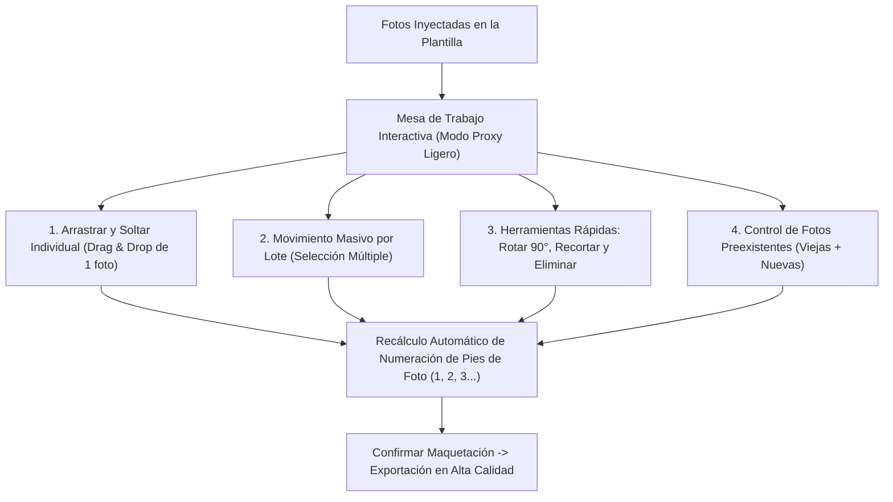

# Mecanismo de Reorganización y Edición Rápida de Fotografías (Mesa de Trabajo)

**Proyecto:** Sistema Inteligente de Gestión, Estampado Georreferenciado y Diligenciamiento Automático de Reportes Fotográficos en Plantillas Empresariales  
**Programa:** Especialización en Inteligencia Artificial  
**Documento:** `docs/03_arquitectura_y_diseno/07_mecanismo_reorganizacion_de_fotografias.md`  

---

## 1. Visión General de la Mesa de Trabajo Interactiva

Una vez que las fotos son inyectadas en la plantilla (ya sean fotos nuevas tomadas en campo o fotos preexistentes de un archivo semidiligenciado), el usuario ingresa a la **Mesa de Trabajo (*Interactive Canvas*)**.

El objetivo de esta pantalla es permitir al usuario **maquetar, ordenar, corregir y perfeccionar el informe en menos de 1 minuto**, directamente desde el celular, sin tener que esperar a llegar a una computadora.



---

## 2. ¿Qué ve el Usuario en la Pantalla? (Diseño Visual)

La pantalla reproduce **exactamente la cuadrícula y las páginas del formato de la empresa**:

```
+-------------------------------------------------------------+
|  <- Mesa de Trabajo (14 Fotos)            [💾 Exportar Doc] |
+-------------------------------------------------------------+
|  [ Modo Selección Múltiple ]             Páginas: [ 1 ] 2  3|
+-------------------------------------------------------------+
|  PÁGINA 1 DE 3  (Plantilla de 4 Fotos por Hoja)              |
|                                                             |
|  +-------------------------+   +-------------------------+  |
|  | [1] Foto #1             |   | [2] Foto #2             |  |
|  | [ Miniatura Proxy ]     |   | [ Miniatura Proxy ]     |  |
|  | Nota: Zapata Torre      |   | Nota: Aislador          |  |
|  | [⟲ Rotar] [✂ Crop] [🗑]  |   | [⟲ Rotar] [✂ Crop] [🗑]  |  |
|  +-------------------------+   +-------------------------+  |
|                                                             |
|  +-------------------------+   +-------------------------+  |
|  | [3] Foto #3             |   | [4] Foto #4             |  |
|  | [ Miniatura Proxy ]     |   | [ Miniatura Proxy ]     |  |
|  | Nota: Puesta a tierra   |   | Nota: Cable guarda      |  |
|  | [⟲ Rotar] [✂ Crop] [🗑]  |   | [⟲ Rotar] [✂ Crop] [🗑]  |  |
|  +-------------------------+   +-------------------------+  |
+-------------------------------------------------------------+
|  Gesto: Mantén presionada una foto para arrastrarla.        |
|  Arrastra hacia el borde inferior para pasar a la Página 2.  |
+-------------------------------------------------------------+
```

---

## 3. Las Formas de Reorganizar las Imágenes

### 3.1. Modo 1: Arrastrar y Soltar Individual (Drag & Drop Clásico)
- **El Gesto:** El usuario mantiene presionado el dedo sobre cualquier fotografía durante 200 ms.
- **La Respuesta Visual:** 
  1. El teléfono emite una pequeña vibración háptica.
  2. La fotografía se eleva ligeramente con una sombra tridimensional.
  3. El usuario arrastra el dedo hacia el recuadro destino deseado.
- **Dos comportamientos inteligentes según la posición:**
  - **Intercambio (*Swap*):** Si suelta la foto sobre otra casilla ocupada, las dos fotos intercambian sus lugares inmediatamente.
  - **Desplazamiento (*Insert & Shift*):** Si suelta la foto entre dos casillas, la foto se inserta allí y todas las siguientes se recorren un espacio hacia adelante.
- **Entre Páginas Diferentes:** Si el usuario arrastra la foto hacia el borde inferior o sobre la pestaña "Página 2", la vista cambia automáticamente de página para permitir soltar la foto en otra hoja.

---

### 3.2. Modo 2: Reorganización Masiva por Lote (Mover Varias Fotos a la Vez)
Cuando el informe tiene 20 o 30 fotos y el usuario necesita mover un bloque completo (por ejemplo, 4 fotos de una misma estructura que quedaron en páginas distintas):
1. El usuario pulsa el botón **"Modo Selección Múltiple"**.
2. Toca con el dedo las fotos que desea agrupar (aparece un check verde `✔` sobre las fotos seleccionadas: ej. Foto 3, Foto 4 y Foto 7).
3. Mantiene presionado cualquiera de los elementos seleccionados y todo el lote se agrupa en una tarjeta flotante (*pila de fotos*).
4. Arrastra el lote hacia la página o sección de destino y lo suelta.
5. Las fotos seleccionadas se reacomodan secuencialmente en el nuevo destino y las demás se reorganizan de forma compacta.

---

### 3.3. Modo 3: Edición Rápida en el Sitio (Rotar, Recortar, Eliminar)
En cada tarjeta de foto, el usuario tiene 3 botones de acción directa sin tener que abrir menús complejos:

1. **Botón Rotar 90° (⟲):**
   - Con cada toque, la foto gira 90° en sentido horario ($0^\circ \rightarrow 90^\circ \rightarrow 180^\circ \rightarrow 270^\circ$).
   - Muy útil para fotos tomadas en vertical que la plantilla de la empresa requiere en horizontal.
2. **Botón Recortar (✂ Crop Inteligente):**
   - Abre un modal rápido con el marco de la celda de la empresa superpuesto.
   - El usuario puede mover o hacer zoom con dos dedos (*pinch-to-zoom*) para encuadrar exactamente el detalle técnico que le interesa (la fisura, la tuerca, la placa del transformador).
3. **Botón Eliminar (🗑):**
   - Si una foto quedó borrosa o repetida, pulsa el cesto de basura.
   - **Reacomodo automático sin huecos:** El sistema remueve la foto y **recorre automáticamente todas las fotos siguientes un espacio hacia atrás**. El informe nunca queda con casillas vacías a la mitad.

---

### 3.4. Modo 4: Reorganización de Fotos Preexistentes (Viejas + Nuevas)
Si el usuario cargó un archivo de Word o Excel que ya tenía fotos pegadas a mano previamente:
- Las fotos que ya estaban en el archivo se cargan en la Mesa de Trabajo con una pequeña etiqueta visual: `[Preexistente]`.
- El usuario **puede moverlas libremente**:
  - Puede arrastrar una foto previa y cambiarla de página.
  - Puede colocar una foto nueva tomada hoy antes de una foto vieja.
  - Puede rotarla o eliminarla si ya no aplica para este informe.

---

## 4. Recálculo Automático de Numeración y Pies de Foto

Uno de los mayores dolores de cabeza en Word y Excel cuando se mueven fotos manualmente es que los pies de foto quedan desordenados (*"Foto 1, Foto 4, Foto 2..."*).

En nuestro sistema:
- Cada celda tiene una variable dinámica `{CONSECUTIVO}`.
- Cada vez que el usuario mueve, intercambia o elimina una foto, el motor **recalcula en milisegundos toda la secuencia numérica**:
  - La foto que quedó en la primera posición pasa a llamarse automáticamente **"Foto N° 1"**.
  - La segunda pasa a ser **"Foto N° 2"**, y así sucesivamente.
- Las notas técnicas asociadas a cada foto viajan junto con su imagen, evitando confusiones de texto.

---

## 5. Rendimiento Extremo: ¿Por qué no se congela el celular? (Modo Proxy)

Si la aplicación intentara mover 30 fotos de 48 Megapíxeles en alta resolución simultáneamente, el teléfono consumiría más de 2 GB de memoria RAM y la pantalla se trabaría.

Para garantizar fluidez a **60 cuadros por segundo**:
1. **Durante la Mesa de Trabajo:** La aplicación trabaja con **Proxies Ligeros (miniaturas en memoria de 480p)** que pesan solo ~100 KB cada una.
2. **Al Momento de Exportar:** El usuario pulsa *"Exportar Documento"*, y el motor aplica todo el orden, los recortes y las rotaciones sobre los **archivos originales de máxima resolución**, generando el Word o Excel con nitidez técnica perfecta.
