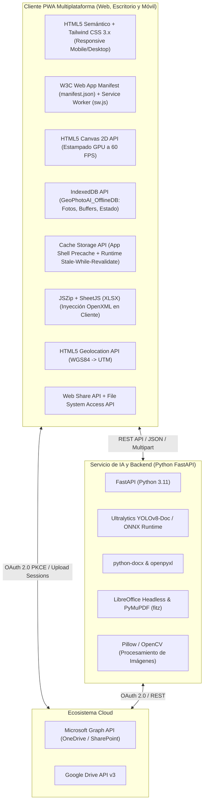

# Stack Tecnológico Recomendado y Justificación

**Proyecto:** Sistema Inteligente de Gestión, Estampado Georreferenciado y Diligenciamiento Automático de Reportes Fotográficos en Plantillas Empresariales  
**Programa:** Especialización en Inteligencia Artificial  
**Modalidad Tecnológica:** Progressive Web App (PWA) Multiplataforma (Web, Escritorio y Móvil) Offline-First  
**Documento:** `docs/04_plan_implementacion_y_evaluacion/01_stack_tecnologico_recomendado.md`  

---

## 1. Resumen del Stack Tecnológico PWA y Multiplataforma

---

## 2. Comparativa y Justificación del Enfoque PWA frente a Alternativas

| Criterio | Progressive Web App (PWA) (Seleccionado) | Flutter / React Native | Aplicación Nativa de Escritorio (Electron / WPF) |
| :--- | :--- | :--- | :--- |
| **Portabilidad Multi-Entorno** | **Universal.** Un solo código corre en Web, Escritorio (Windows, macOS, Linux) y Móvil (Android, iOS). | Excelente en Android e iOS, pero el despliegue en web y escritorio requiere adaptaciones considerables. | Limitado exclusivamente a ordenadores de escritorio (Windows/Mac/Linux). Inviable para celulares en campo. |
| **Instalabilidad** | **Instantánea sin Tiendas.** Se instala directamente desde el navegador (Chrome, Edge, Safari) con un solo clic. | Requiere compilación y distribución pesada vía APKs manuales o tiendas (Google Play, App Store). | Instalador pesado (.exe / .msi) con dependencias de entorno y privilegios de administrador. |
| **Capacidad Offline** | **100% Autónoma.** Service Worker almacena el App Shell; IndexedDB almacena cientos de MB de fotos y buffers de plantillas. | Soporte nativo offline con SQLite y almacenamiento local. | Soporte offline nativo sobre el sistema de archivos del sistema operativo. |
| **Huella de Instalación y Peso** | **Ultra-ligera (< 5 MB).** Solo almacena recursos de caché en el dispositivo. | Pesada ($35 - 70$ MB por binario compilado). | Muy pesada ($150 - 250$ MB al empaquetar Chromium y Node). |
| **Velocidad de Mantenimiento** | **Actualización instantánea.** Nuevas versiones se distribuyen al recargar la web vía Service Worker (`onupdatefound`). | Requiere nuevo empaquetado, firma de claves y actualización manual por parte del usuario. | Requiere gestor de auto-actualización dedicado. |

---

## 3. Justificación de Componentes de la Arquitectura PWA

### 3.1. Núcleo PWA: Service Worker y Manifiesto W3C
- **`manifest.json`:**  
  Declara el comportamiento de aplicación independiente (`display: "standalone"`), colores temáticos (`theme_color: "#0f172a"`), iconos corporativos en resoluciones estándar y maskables (192x192 y 512x512 px) y atajos rápidos de teclado/táctil (*Shortcuts* para Cámara, Mesa y Formatos).
- **`sw.js` (Service Worker):**  
  Intercepta el ciclo de vida de red. Implementa *Pre-caching* para que los archivos fundamentales carguen instantáneamente desde el primer milisegundo y *Stale-While-Revalidate* para librerías en CDNs, asegurando que la herramienta abra incluso en modo avión.

### 3.2. Persistencia en Cliente: IndexedDB (`GeoPhotoAI_OfflineDB`)
- **IndexedDB vs. `localStorage`:**  
  `localStorage` se encuentra restringido a 5 MB por origen y no admite tipos de datos binarios, lo que causaría excepciones inmediatas al manejar reportes de más de dos fotos.  
- **IndexedDB** ofrece almacenamiento estructurado transaccional de cientos de megabytes en el navegador, permitiendo persistir:
  1. `state.photos`: Colección de fotos en alta resolución con sus recortes, rotaciones y pies de foto.
  2. `state.template.rawBuffer`: El archivo binario original de Word (`.docx`) y Excel (`.xlsx`), permitiendo la inyección directa sin pérdida de membretes aun sin internet.
  3. `state.config`: Perfil de estampado personalizado.
  4. `state.syncQueue`: Cola *Outbox* para sincronización automática diferida.

### 3.3. Procesamiento OpenXML en el Cliente (JSZip & SheetJS)
- **JSZip:**  
  Permite descomprimir archivos `.docx` directamente en memoria, parsear `word/document.xml`, detectar tablas, clonar bloques de celdas repetitivas, inyectar imágenes en `word/media/` y reempaquetar el documento modificado a 60 FPS en el cliente.
- **SheetJS (xlsx):**  
  Procesa y genera libros de trabajo de Microsoft Excel (`.xlsx`), inyectando hojas de control y matrices de evidencias tabuladas.

---

## 4. Backend y Servicio de Inteligencia Artificial (Python)

- **FastAPI:**  
  Framework web asíncrono de alto rendimiento basado en Starlette y Pydantic. Ofrece validación automática de tipos, documentación interactiva OpenAPI y mínima sobrecarga para endpoints de análisis asistido de plantillas.
- **Ultralytics YOLOv8-Doc (Visión por Computadora):**  
  Seleccionado por su óptima relación entre precisión (*mAP*) y velocidad de inferencia (< 40 ms en GPU, < 180 ms en CPU). Puede exportarse fácilmente a formato **ONNX** para inferencia acelerada.
- **PyMuPDF (fitz) + LibreOffice Headless:**  
  Permite renderizar páginas de `.docx` y `.xlsx` a imágenes de 150 DPI para alimentar el pipeline de visión artificial con fidelidad visual 100% idéntica a Microsoft Office.
- **python-docx & openpyxl:**  
  Librerías de manipulación OpenXML del lado del servidor para análisis avanzado y reconstrucción de documentos corporativos.

---

## 5. Integraciones Cloud y Seguridad

- **Microsoft Authentication Library (MSAL) & Microsoft Graph API:**  
  Conexión OAuth 2.0 PKCE con cuentas corporativas de Microsoft 365, OneDrive y SharePoint para subida en sesiones fragmentadas (*Chunked Upload Sessions*).
- **Google Drive API v3:**  
  Integración con Google Drive con soporte de *Resumable Upload* para tolerar interrupciones de conectividad en campo.
