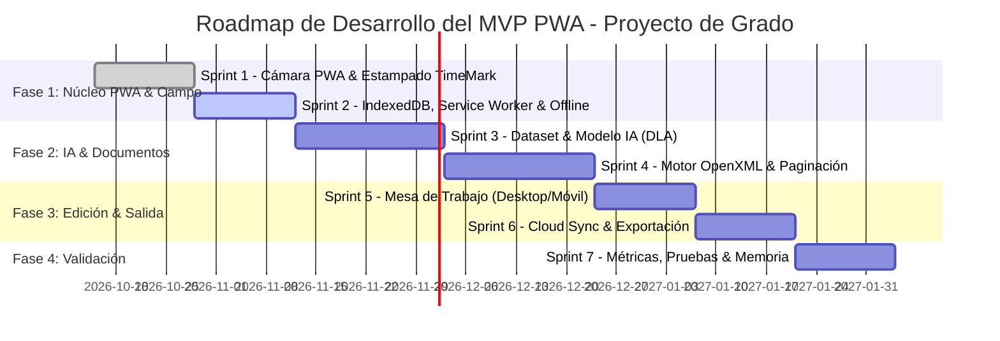

# Roadmap y Fases de Desarrollo del Producto Mínimo Viable (MVP)

**Proyecto:** Sistema Inteligente de Gestión, Estampado Georreferenciado y Diligenciamiento Automático de Reportes Fotográficos en Plantillas Empresariales  
**Programa:** Especialización en Inteligencia Artificial  
**Modalidad Tecnológica:** Progressive Web App (PWA) Multiplataforma (Web, Escritorio y Móvil) Offline-First  
**Documento:** `docs/04_plan_implementacion_y_evaluacion/03_roadmap_y_fases_mvp.md`  

---

## 1. Estrategia de Entrega Iterativa del MVP

El desarrollo del proyecto de grado se estructura en **7 Sprints de 2 a 3 semanas cada uno**, organizados para garantizar entregables funcionales verificables desde las etapas tempranas con enfoque **PWA Multiplataforma**:

---

## 2. Detalle de Sprints y Criterios de Culminación (Definition of Done)

### Sprint 1: Módulo PWA de Captura y Estampado Configurable (Estilo TimeMark)
- **Objetivos:**
  - Configurar la estructura PWA con HTML5, Tailwind CSS y Canvas 2D acelerado.
  - Implementar la vista de cámara en vivo y captura a resolución completa.
  - Diseñar el motor gráfico de estampado sobre Canvas: fecha/hora, coordenadas GPS (WGS84 y UTM), logo corporativo y texto libre.
  - Implementar el control deslizante de transparencia de la caja de fondo ($0\% - 100\%$) y la previsualización en vivo.
- **Entregable:** PWA funcional que captura y estampa fotografías con parámetros totalmente configurables en navegadores móviles y de escritorio.

---

### Sprint 2: Persistencia Local Offline-First con IndexedDB y Service Worker
- **Objetivos:**
  - Implementar el Service Worker (`sw.js`) con estrategias de precaché del App Shell y *Stale-While-Revalidate* de librerías.
  - Configurar la base de datos IndexedDB (`GeoPhotoAI_OfflineDB`) con almacenes para `app_state`, `photos`, `template_data` y `sync_queue`.
  - Crear el Web App Manifest (`manifest.json`) con soporte de instalación independiente (*standalone*), atajos e iconos multi-resolución.
  - Auto-guardado reactivo (*debounced autosave*) para evitar pérdidas de datos ante cierres de ventana.
- **Entregable:** Aplicación 100% instalable en Android, iOS, Windows y macOS con funcionamiento autónomo sin internet y almacenamiento de buffers binarios.

---

### Sprint 3: Modelo de Inteligencia Artificial para Detección de Plantillas (DLA)
- **Objetivos:**
  - Recolección y etiquetado de 50 plantillas empresariales heterogéneas (`.docx` y `.xlsx`).
  - Pipeline de conversión de plantillas a imagen (PDF intermedio + PyMuPDF a 150 DPI).
  - Entrenamiento / *Fine-tuning* del modelo YOLOv8-Doc con las clases `photo_placeholder`, `caption_slot`, `header_info`, `logo_slot`.
  - Exportación del modelo a ONNX e integración en el microservicio FastAPI.
- **Entregable:** Servicio de IA que recibe un archivo Word/Excel y retorna las coordenadas y confianza de los recuadros de fotos identificados.

---

### Sprint 4: Motor de Mapeo OpenXML, Inyección y Paginación Dinámica
- **Objetivos:**
  - Algoritmo de correspondencia geométrica: mapeo de bounding boxes de la IA a celdas de Word (`<w:tc>`) y Excel (`<xdr:twoCellAnchor>`).
  - Motor de inyección en cliente (JSZip) preservando incondicionalmente membretes y logos en encabezados/pies de página.
  - Motor de clonación dinámica: duplicación automática de tablas y saltos de página ante excedentes de fotos con celdas de tamaño uniforme (`standardCx`, `standardCy`).
  - Inspección de estado previo: reanudación de reportes con fotos existentes cargándolas directamente a la mesa de trabajo.
- **Entregable:** Generación exitosa de documentos Word y Excel con cualquier cantidad de fotos inyectadas sin alterar formatos institucionales.

---

### Sprint 5: Mesa de Trabajo Multiplataforma (Reorganización y Edición Rápida)
- **Objetivos:**
  - Implementar doble layout adaptable: Modo Marco Móvil para campo y Modo Pantalla Ancha Expandido (`desktop-expanded`) para ordenadores de escritorio.
  - Paginación compacta (`P1, P2...`) y diálogo modal para mover fotos directamente entre páginas.
  - Gestos de arrastrar y soltar (*Drag & Drop*) para intercambiar fotos individualmente o en bloque.
  - Controles de edición rápida: rotación de 90° con persistencia al exportar, zoom de alta resolución (*Lightbox*) con doble clic y recorte con control de escala.
- **Entregable:** Interfaz interactiva donde el usuario organiza y edita visualmente su reporte antes de exportarlo en cualquier dispositivo.

---

### Sprint 6: Conectores en la Nube y Exportación Personalizada
- **Objetivos:**
  - Diálogo modal de exportación para permitir al usuario personalizar el nombre del reporte (`.docx`, `.xlsx`, `.pdf`) antes de la descarga.
  - Despachador de sincronización en segundo plano (*Background Sync Outbox*) con cola diferida en IndexedDB/SQLite.
  - Integración de subidas a Microsoft 365 (OneDrive / SharePoint) y Google Drive con sesiones fragmentadas.
  - Compartición directa a través de Web Share API hacia WhatsApp, Telegram y correo electrónico.
- **Entregable:** Capacidad de exportar y compartir inmediatamente el informe terminado o guardarlo en carpetas corporativas compartidas.

---

### Sprint 7: Validación Experimental, Pruebas de Campo y Documento de Grado
- **Objetivos:**
  - Ejecución de pruebas del benchmark de plantillas: cálculo de IoU, mAP, Slot Assignment Accuracy y tiempos de respuesta.
  - Pruebas piloto en campo simulando una inspección real sin conexión en teléfonos Android y computadores portátiles.
  - Redacción formal de la memoria del proyecto de grado de especialización en IA.
  - Preparación de diapositivas y video demostrativo para la sustentación académica.
- **Entregable:** Documento final de grado aprobado, repositorio de código limpio y prototipo PWA validado.
